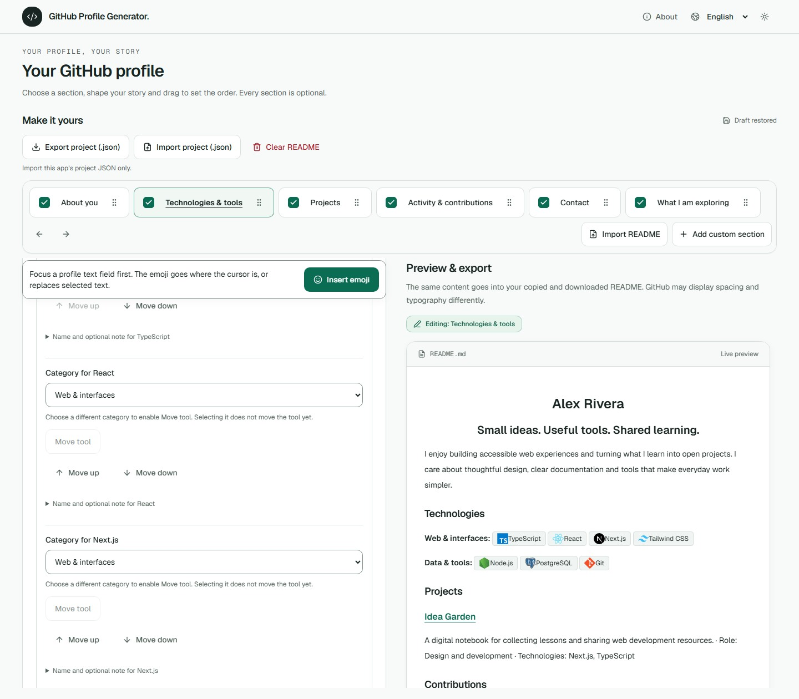
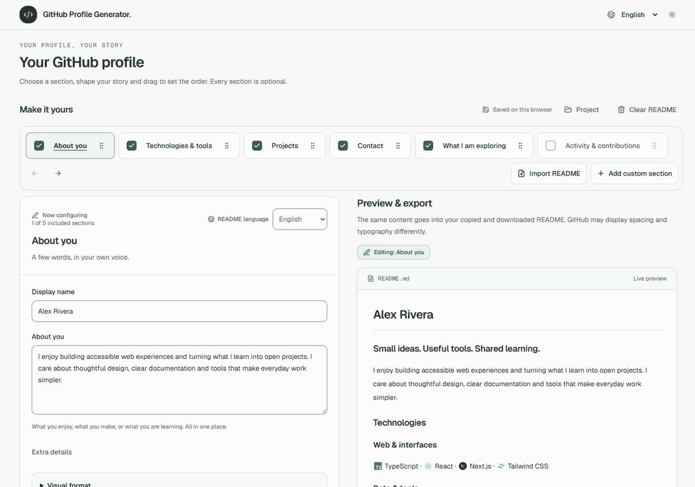

# GitHub Profile Generator

**Create your GitHub profile README with a visual editor.**

Introduce yourself, share your tools and show what you build. Choose your sections, preview the result as you edit and bring your `README.md` to GitHub. Save the complete project as JSON to keep editing another day, even on another device.

**No sign-in required to build your profile · English and Español interface · Original code licensed under MIT**

[How it works](#how-it-works) · [Save and continue later](#save-and-continue-later) · [Run locally](#run-locally) · [Documentation](#documentation) · [Contribute](CONTRIBUTING.md)



_A real editor screenshot with a fictional profile. Open the [example project](docs/examples/demo-profile.project.json) with **Import project (.json)** to explore it._

## What you can create

A short profile can tell a story. Every section is optional: start with a few words, some tools or a link, whether or not you have projects or public activity to share.

| What you want to share                | What the editor offers                                                                                                             |
| ------------------------------------- | ---------------------------------------------------------------------------------------------------------------------------------- |
| **Who you are**                       | A centered intro with writing examples, an optional country line, and italic or monospace title styles.                            |
| **What you build with**               | A searchable technology catalog with icons, editable categories and custom names.                                                  |
| **What you do**                       | Projects and contributions to code, documentation, reviews or communities, with context and links.                                 |
| **Your own content**                  | Repeatable sections with text, lists, links, headings, quotes, dividers, public images, filtered HTML and syntax-highlighted code. |
| **Where to find you**                 | Social profiles, a portfolio, websites and email.                                                                                  |
| **Public activity, if you choose it** | Ten optional card types with themes and colors; they require the configuration described [below](#optional-activity-and-cards).    |

Reorder sections by dragging, using the keyboard or pressing the arrow buttons. Hide a section while keeping its content. On desktop, editing and preview appear side by side; on smaller screens, switch between them. Light and dark themes are available.

<details>
<summary>Watch an animated editor tour</summary>



The animation shows real editor states using the same fictional profile. It predates the current project import dialog; **Export project (.json)** and **Import project (.json)** now appear in the editor header. The screenshot above offers a still view without opening the animation.

</details>

## How it works

1. **Choose what to share.** Open the editor and add the sections that work for you. Fill them in at your own pace.
2. **Edit and preview.** Write, choose technologies and arrange your content. Preview, copy and download all use the same generated Markdown.
3. **Bring it to GitHub.** Use **Copy README** or **Download README**, then place the file at the root of a public repository named exactly like your GitHub username. Follow [GitHub's official profile README guide](https://docs.github.com/en/account-and-profile/how-tos/profile-customization/managing-your-profile-readme) to publish it.

The app prepares the file; you decide when to publish it. GitHub applies its own styles and filters, so the published result may look different from the preview.

## Save and continue later

**Keep editing without starting over.** Your draft is saved in your browser, and you can download a complete copy to continue later or on another device.

| File                          | What it is for                                                                              |
| ----------------------------- | ------------------------------------------------------------------------------------------- |
| `README.md`                   | Publishing your introduction on GitHub.                                                     |
| `github-profile.project.json` | Reopening your profile in this generator to keep editing its fields, sections and settings. |

1. Choose **Export project (.json)** below the editor heading to download your work.
2. When you return, choose **Import project (.json)** beside it, then select that `.json` file in the dialog.
3. Review the summary and confirm replacement of the open profile. The app first tries to save a recovery copy of your previous profile.

On mobile, the same buttons read **Export JSON** and **Import JSON**. Import accepts only JSON files with this generator’s project structure; generic JSON and GitHub profile or API exports are not compatible.

The project keeps your text, order, categories, formatting and hidden content. You can also save unfinished work, even when the README still needs corrections. Opening a project replaces the whole profile after confirmation; it does not merge two projects. Local files up to **4 MiB** are processed on your device.

Want to try it first? Download the [example project](docs/examples/demo-profile.project.json) and import it with **Import project (.json)**. It uses fictional data and links to `example.com`.

> Browser drafts do not sync across devices and can be lost if you clear browser data. Keep the JSON file to continue editing. The [editor guide](docs/editor.md#guardar-y-abrir-proyectos) explains local backups and recovery in Spanish.

## Start with an existing README

Use **Import README** to paste Markdown or open a `.md` file. The editor analyzes it and proposes custom sections that you can review and exclude before confirming.

The conversion reports formatting changes and content that needs attention; it does not automatically reconstruct the original fields of a JSON project. Before replacing the profile, the app tries to save both the previous profile and the original Markdown. Images and cards remain inactive during review.

Read the [import and recovery guide](docs/editor.md#importar-un-readme-existente) for its limits and the options available if storage fails.

## Run locally

You need **Node.js 24.21.0** and **pnpm 11.25.0**. Versions are pinned in `.nvmrc` and `package.json`.

```sh
git clone https://github.com/juanNH/ReadmeGenerator.git
cd ReadmeGenerator
pnpm install --frozen-lockfile
pnpm dev
```

Open the editor in [English](http://127.0.0.1:3000/en/editor) or [Español](http://127.0.0.1:3000/es/editor). Building a profile manually requires no environment variables or GitHub account. The app defaults to English and lets you switch languages; your own writing stays in the language you entered.

To serve a production build:

```sh
pnpm build
pnpm start
```

The [development guide](docs/development.md) covers commands, environment setup and the scope of verification.

## Optional activity and cards

Describe your contributions manually without querying an account. If the server operator configures the integration, **Search data** fetches public GitHub data so you can choose which cards to show. All cards start disabled. Searching requires an explicit action, and available data is reused temporarily to avoid repeated requests.

Cards include a calendar, summary, languages, overview and monthly activity, plus five families adapted from GitHub Stats Extended: statistics, languages, repositories, Gists and WakaTime. Charts are rendered by this app with configurable themes and appearance. WakaTime uses a separate username with public statistics.

| Server configuration | When it is needed                                                                                                                     |
| -------------------- | ------------------------------------------------------------------------------------------------------------------------------------- |
| `GITHUB_TOKEN`       | To query GitHub: a dedicated classic PAT with only `public_repo`, validated by the server and kept out of the browser.                |
| `APP_URL`            | To export cards: the public HTTPS origin of the instance hosting their SVGs. A localhost server cannot make them available on GitHub. |

Without a configured public origin, you can review cards locally; README copy and download remain disabled while cards are selected. Deselect them to export your manually entered content. Saving the JSON project remains available.

On Vercel Production, an empty `APP_URL` uses the project's stable production domain from Vercel's system environment variables. Preview and local instances still need an explicit `APP_URL` to export cards. The card URLs must be publicly accessible without authentication. See the [deployment guide](docs/vercel-deployment.md#3-variables-por-entorno).

Configuration and limits are documented in [.env.example](.env.example), [GitHub and hosting](docs/development.md#configurar-actividad-de-github) and [supported cards](docs/github-stats-extended.md). Public activity does not determine a person's ability, and the optional rank does not measure it either.

## Your data

Your profile is edited and saved in the browser. Project files and imported Markdown are analyzed locally; drafts are not synced remotely. If storage fails, the editor explains that your work remains only in memory and offers the relevant recovery actions.

Public images load from their original servers. Optional searches contact GitHub or WakaTime through the app's server. Icons use local catalogs in the editor and pinned source references in exported READMEs. The generator does not upload your images or publish to your GitHub account. It includes no AI assistance.

## Development and contributions

The project uses **Next.js App Router, React, TypeScript, Tailwind CSS and next-intl**. The profile model and Markdown generator live in a core independent of the interface, network and storage.

Run `pnpm check` and `pnpm build` to review a change; browser checks use Playwright. See [CONTRIBUTING.md](CONTRIBUTING.md) for setup and checks appropriate to each change, and the [branching guide](docs/branching.md) for branch names and pull-request targets. The internal `/design-system` catalog is available only in development.

Found a bug or have a suggestion? Open an [issue](https://github.com/juanNH/ReadmeGenerator/issues) with the expected behavior and, for a bug, the steps to reproduce it. Keep credentials and private data out of reports.

## Documentation

Most detailed product and development guides are currently in Spanish. The [branching guide](docs/branching.md) is available in English.

Despliegue con PAT y sin login: [Vercel Hobby, main/Dev y comprobación de tarjetas](docs/vercel-deployment.md).

| To…                                               | Read                                                                          |
| ------------------------------------------------- | ----------------------------------------------------------------------------- |
| Use the editor, save projects and import Markdown | [Editor guide](docs/editor.md)                                                |
| Understand the product and its limits             | [Product](docs/product.md)                                                    |
| Install, configure and verify the app             | [Development](docs/development.md)                                            |
| Configure queries and publish cards               | [GitHub and hosting](docs/development.md#configurar-actividad-de-github)      |
| Understand the architecture and data format       | [Architecture](docs/architecture.md) · [Profile model](docs/profile-model.md) |
| Explore the other guides and decisions            | [Documentation index](docs/README.md)                                         |

## License

Original code is licensed under [MIT](LICENSE), with `Copyright (c) 2026 Juan Nicolas Herrera`. Third-party materials retain their own licenses and attribution; see [THIRD_PARTY_NOTICES.md](THIRD_PARTY_NOTICES.md) and the [open-source guide](docs/open-source.md).

The generator's license does not change the rights to the content each person adds to their README.
