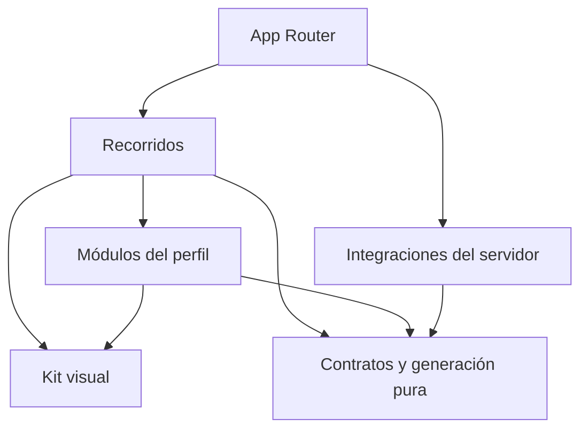

# Arquitectura

## Estado y objetivo

GitHub Profile Generator ayuda a componer un README mediante módulos opcionales. La base actual prepara Next.js App Router, TypeScript estricto, un kit visual reutilizable, idiomas inglés y español y controles de calidad. El editor y sus integraciones todavía no están implementados.

El nombre `ProfileDocument` expresa el contrato previsto; este documento describe sus límites de responsabilidad y no afirma que ese modelo o el generador ya existan.

## Una aplicación, responsabilidades explícitas

El repositorio contiene una aplicación Next.js. Las carpetas delimitan responsabilidades; se crean implementaciones cuando una tarea real las necesita. No se requieren monorepo, microservicios, inyección de dependencias o capas repetidas para cada función.

| Ámbito                 | Responsabilidad                                                    | Restricciones principales                                                 |
| ---------------------- | ------------------------------------------------------------------ | ------------------------------------------------------------------------- |
| `src/app/`             | Rutas, layouts, metadatos y composición de páginas.                | Mantener entradas pequeñas; evitar reglas del perfil dentro de las rutas. |
| `src/app/[locale]/`    | Páginas públicas y layouts localizados.                            | Validar locales soportados y emitir el `lang` correspondiente.            |
| `src/components/ui/`   | Primitivas accesibles y variantes del kit visual.                  | Sin reglas de negocio, clientes externos o estado del perfil.             |
| `src/components/`      | Composiciones visuales compartidas y proveedores necesarios.       | Extraer cuando exista reutilización o una responsabilidad clara.          |
| `src/features/`        | Comportamientos y recorridos, como el futuro editor o exportación. | Coordinar módulos; no duplicar reglas de generación.                      |
| `src/modules/`         | Formularios y presentación específica de cada sección del perfil.  | No depender directamente de otros módulos.                                |
| `src/core/`            | Futuros contratos, validaciones y generación del README.           | TypeScript puro, sin framework, red, almacenamiento o secretos.           |
| `src/server/`          | Integraciones y operaciones que necesitan una frontera segura.     | `server-only`; sin importación desde código cliente.                      |
| `src/i18n/` y mensajes | Resolución de locale, navegación y traducciones por namespace.     | Inglés inicial, español completo y textos fuera de los componentes.       |

La ubicación exacta de archivos compartidos sigue el código existente. No mover utilidades sólo para reproducir un esquema de carpetas.

Las flechas indican dependencias permitidas, no obligatorias. `core` no depende de los demás ámbitos. El navegador sólo accede a servicios del servidor mediante una frontera explícita que valide sus entradas y controle su salida.

## Renderizado y estado

Las páginas y layouts son Server Components por defecto. Un componente se convierte en cliente cuando necesita eventos, estado o APIs del navegador. La frontera debe ser pequeña: un selector interactivo no exige que toda la página se ejecute en el cliente.

El contenido estático se renderiza primero. Las esperas independientes se aíslan con estados de carga y `Suspense` cuando se incorporen datos asíncronos. No bloquear una página entera por un módulo opcional ni duplicar solicitudes en varios componentes.

Los futuros formularios tendrán estado local para interacción efímera. El documento del perfil será la fuente de verdad de los datos guardados. Datos derivados, resultado del generador y estado remoto no se copian a múltiples almacenes sin una necesidad demostrable. La persistencia del navegador deberá recuperarse después de la hidratación sin reemplazar accidentalmente un borrador con valores iniciales.

No incorporar `useMemo`, `useCallback` o un almacén global por costumbre. Elegirlos ante una necesidad de identidad, alcance o rendimiento comprobable y mantener simple el código que no lo requiera.

## Kit visual e idiomas

La base utiliza Tailwind CSS, primitivas Radix, componentes propios con el enfoque de shadcn, variantes con CVA, iconos Lucide y temas con `next-themes`. Los colores, espaciado, tipografía, radios y estados se expresan mediante tokens compartidos. Los componentes de producto reutilizan esas decisiones en lugar de copiar estilos de una página a otra.

Las rutas base son `/en`, `/es`, `/en/design-system` y `/es/design-system`; `/` redirige a `/en`. `next-intl` resuelve los mensajes por namespace. El selector conserva la página equivalente y expresa los idiomas mediante sus nombres, sin banderas. Inglés y español se validan como recorridos reales. El idioma del editor y el contenido escrito por la persona son conceptos distintos: cambiar la interfaz no traduce ni modifica automáticamente su perfil.

Cada interacción requiere semántica, etiqueta accesible, foco visible, uso por teclado y estados comprensibles. Respetar preferencias de movimiento y tema. Las pruebas automáticas ayudan a detectar problemas; la revisión manual comprueba foco, lectura, navegación y claridad de mensajes.

## Límites del contrato del perfil y la generación

El contrato del perfil deberá ser serializable y versionado. Separará los datos del perfil, el idioma de contenido y la composición de los módulos. Los cambios de esquema necesitarán una evolución explícita. Cada módulo es opcional: presentación, capacidades, tecnologías, formación, actualidad, proyectos, contribuciones, métricas y contacto.

Los tipos y validaciones puros pertenecerán a `core`. El registro que asocie secciones con formularios se compondrá fuera de `core`, para que el modelo nunca importe React. El generador recibirá datos explícitos y producirá una salida determinista compatible con GitHub. La vista previa se derivará de esa misma salida.

Ocultar un módulo conservará sus datos y excluirá su contenido del README. Una actividad pública baja no invalidará capacidades, formación o experiencia declaradas. La generación escapará texto y enlaces según su contexto; el HTML de entrada no podrá eludir estas reglas.

El guardado inicial se realizará en el navegador cuando se implemente. La exportación del README y la exportación de la configuración tendrán fines distintos: publicar el resultado y continuar editándolo. Importar configuración necesitará validación, control de versión y una interacción que permita cancelar antes de reemplazar el trabajo existente.

## GitHub e IA: evolución prevista

Las integraciones con GitHub residirán en `server`. Antes de exponer una operación se definirán sus datos permitidos, permisos, caché, límites de uso, timeout y tratamiento de errores. Un fallo externo dejará disponible la edición manual. Las métricas exportadas como captura y las tarjetas que continúan actualizándose tendrán comportamientos explícitos y diferentes requisitos de alojamiento.

La asistencia con IA será una feature posterior. Propondrá cambios estructurados sobre el modelo existente, con validación y revisión del usuario antes de aplicarlos. El generador puro seguirá produciendo el README. Se podrá aceptar o descartar una propuesta y recuperar el contenido anterior. No se inferirán capacidades a partir de actividad ni se inventará trayectoria.

Preparar esta evolución consiste hoy en separar responsabilidades y documentar contratos previstos. No instalar SDKs de IA, crear endpoints públicos vacíos, incluir prompts sin consumidor ni solicitar claves hasta implementar una feature concreta. Las credenciales permanecerán en el servidor y se enviarán al proveedor únicamente los datos necesarios para la acción solicitada.

## Cambios y evidencia

Un cambio transversal requiere acordar alcance, dependencias y criterios de aceptación antes de implementarlo. La planificación se conserva en el espacio privado autorizado; la ruta local opcional `.private/planning/` queda fuera del control de versiones. La propuesta pública debe explicar su objetivo sin adjuntar ese contenido. Una decisión que cambia límites, persistencia o proveedores se registra en `docs/decisions/` con alternativas y consecuencias. Las correcciones locales no necesitan un ADR nuevo.

Las pruebas se ubican junto a la conducta que protegen o en el ámbito de integración correspondiente. Las reglas puras requieren pruebas deterministas; los componentes, interacciones significativas; las integraciones, respuestas controladas; y los recorridos completos, pruebas de navegador cuando existan. No depender de credenciales ni solicitudes facturables para la validación habitual.

La configuración y las versiones concretas viven en `package.json` y el lockfile. Este documento describe límites de responsabilidad. Consultar [trabajo con IA](ai-development.md), [contribuciones](../CONTRIBUTING.md) y la [decisión inicial](decisions/0001-architecture.md) antes de modificarlos.
