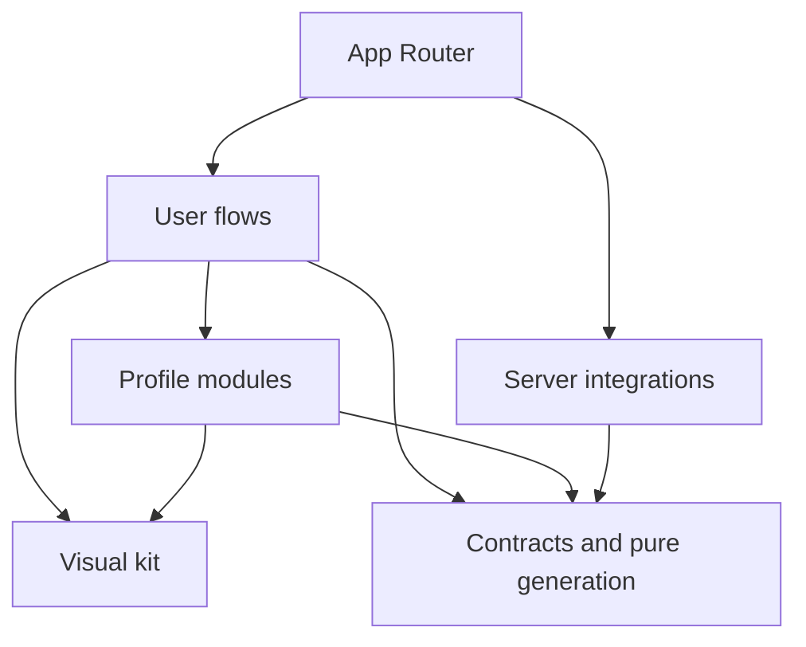

# Architecture

## Status and goal

GitHub Profile Generator helps compose a brief README through five optional fixed sections and repeatable custom sections. It includes Next.js App Router, strict TypeScript, a bilingual visual kit, stable configuration, drag-and-drop, preview, export, and a local draft. Activity integrates an optional configurable public GitHub query and first-party SVGs; the manual flow needs no credentials. Skills, education, and current focus remain retired, and their legacy structures are preserved. There is no AI assistance.

`ProfileDocument` version 2, its mixed ordering, module registry, custom blocks, and operations for creation, validation, visibility, duplication, and ordering are implemented in `src/core/`. Visual variants, explicit HTML, literal code, and bounded formatting extend composition without changing the version or storage keys. Its API and v1 compatibility are described in the [profile model](profile-model.md).

## One application, explicit responsibilities

The repository contains one Next.js application. Folders define responsibilities; implementations are added when a real task needs them. A monorepo, microservices, dependency injection, or repeated layers for every function are not required.

| Area                     | Responsibility                                                     | Main constraints                                                                   |
| ------------------------ | ------------------------------------------------------------------ | ---------------------------------------------------------------------------------- |
| `src/app/`               | Routes, layouts, metadata, and page composition.                   | Keep entry points small; avoid putting profile rules in routes.                    |
| `src/app/[locale]/`      | Public pages and localized layouts.                                | Validate supported locales and emit the corresponding `lang`.                      |
| `src/components/ui/`     | Accessible primitives and visual-kit variants.                     | No business rules, external clients, or profile state.                             |
| `src/components/`        | Shared visual compositions and required providers.                 | Extract when reuse or a clear responsibility exists.                               |
| `src/features/`          | Editor, preview, export, and local draft persistence.              | Coordinate modules; do not duplicate generation rules.                             |
| `src/modules/`           | Forms and presentation specific to each profile section.           | Do not depend directly on other modules.                                           |
| `src/core/`              | Contract, validation, registry, operations, and README generation. | Pure TypeScript, without a framework, network, storage, or secrets.                |
| `src/server/`            | Integrations and operations that need a secure boundary.           | `server-only`; never import from client code.                                      |
| `src/i18n/` and messages | Locale resolution, navigation, and namespace translations.         | English by default, full Spanish support, and no UI copy hard-coded in components. |

The exact location of shared files follows the existing code. Do not move utilities solely to reproduce a folder scheme.

The arrows indicate permitted dependencies, not required ones. `core` does not depend on other areas. The browser accesses server services only through an explicit boundary that validates inputs and controls outputs.

## Rendering and state

Pages and layouts are Server Components by default. A component becomes a client component when it needs events, state, or browser APIs. Keep the boundary small: an interactive selector does not require the entire page to run on the client.

Render available static content first. Isolate independent waits with loading states and `Suspense` when asynchronous data is introduced. Do not block an entire page for an optional module or duplicate requests across multiple components.

The localized editor route composes the header and messages on the server and injects only the validated public card origin, without credentials. It uses `await connection()` to resolve `APP_URL` on each request or, if it is empty and `VERCEL_ENV=production`, the stable domain from `VERCEL_PROJECT_PRODUCTION_URL`. Changing configuration requires restarting the service or redeploying on Vercel; the origin is not fixed at build time. The editor renders dynamically, while the landing page and design system retain static generation. `EditorWorkspace` owns client interaction and the profile document. Markdown, errors, and export restrictions derive from the generator, with no second README representation. Forms live in `src/modules/`; `EditorModules` and `ContactProviders` group their EN/ES messages. The `core` registry contains only data and schemas, without components or icons.

The editor offers the same five fixed sections plus custom instances, with no alternative forms for retired data. The registry retains nine fixed IDs for internal compatibility. `knowledge`, `education`, and `current` do not participate in navigation or generation even when they contain data or are visible; their values are preserved without merging them into presentation. Presentation offers name, headline, free text, and visible location, with help that does not add content to the document. `modules/custom` edits custom blocks without extending the fixed modules' fields. Its selector shows ten options with decorative local examples and EN/ES descriptions, without adding sample content to the document. HTML and literal code have their own source editors; list helpers remain limited to paragraphs and lists. Adding focuses the new field or divider heading; ordering, removing, and duplicating preserve focus targets and announcements.

`CodeEditor` is a small client boundary in `components/ui`, shared by HTML and code. It loads CodeMirror 6 and its parsers dynamically, after a source block mounts, with a labeled textarea while loading and a “Plain text” alternative. Highlighting is local and does not validate export. The surface keeps original source separate from the LF document used by CodeMirror: operations map positions to preserve BOM, whitespace, and CRLF/CR line endings untouched by an edit, and paste retains incoming line endings. Selection and history belong to each block; duplicates have independent instances. Tab moves focus to the next control, indentation uses commands or buttons, and line wrapping/scrolling stays within the editor. A missing parser or load failure leaves source editable as text. Code is not executed and no remote service is added.

`CodePreview` presents code through React text and locally loaded highlighting spans; an unknown language is shown without highlighting. The copy button belongs to the application and is not exported. Fences keep HTML, icons, and image syntax as text: plugins do not turn them into active resources. Preview, README copy, and download continue to use the same Markdown.

Active selection is ephemeral UI state, separate from `visibility`. Compact navigation shows included sections first, followed by hidden sections. The checkbox changes inclusion only, retaining focus and data; the button with the section name selects its form and focuses its heading. For a hidden section, the action is identified as add and edit. One form occupies the configuration panel alongside the README language; other forms are not mounted. Navigation, heading, and preview indicate which section is being edited without changing Markdown.

Top navigation retains the active section and always displays sections in a single horizontal row. Its checkboxes, buttons, and handles provide inclusion, selection, and ordering on the same surface. On wide screens, configuration and preview occupy two panels. On narrow screens, Edit/Preview buttons communicate their state through `aria-pressed`; they are hidden when both panels are visible. This view selection is also not saved in the document. Add/remove controls manage focus using opaque document IDs and independent DOM IDs. Output errors are associated with a field and section; reviewing them selects the form, displays the editor, and focuses the invalid field.

`module-composition.ts` calculates the included fixed and custom references and moves one to a visible index. It rebuilds `sectionOrder` by placing that sequence into the same slots: hidden, retired, and `metrics` references keep their positions. UI keys distinguish custom instances from fixed modules and do not depend on titles. The final operation goes through `reorderSections`; this order determines output. Visual grouping of included and hidden sections does not introduce a second persisted order.

Activity and contributions use the `contributions` slot. Effective inclusion is `visibility.contributions || visibility.metrics`; there is no sixth section. Recovery does not modify flags. Hiding through the global checkbox turns both off; showing again enables contributions and metrics if cards remain selected. Manual contributions respect their flag, and cards respect the metrics flag. The generator composes both sources in the contributions position and never renders metrics separately. Its internal position is retained when reordering.

Contribution items preserve their array order and can be moved with explicit form controls. V2 may add up to ten links and three public HTTPS images with alternative text. Older v2 repository preview data remains readable and is emitted as an ordinary link and description; the editor no longer offers a separate repository control. Activity `cardColumns` and `contentOrder` are optional v2 values: columns choose the GFM layout and card text sizing, while content order chooses whether activity or manual contributions appear first. The generator uses the same Markdown and validated derived-HTML metadata consumed by the preview.

Drag-and-drop uses `@dnd-kit/react` and `@dnd-kit/dom` 0.5.1 in the client navigation boundary. Only the handle starts an operation through pointer or keyboard sensors; writing, checking a box, or selecting the name does not start a drag. The touch-gesture restriction applies only to the handle. During the gesture, React presents a temporary projection of the sequence; the library's optimistic DOM sorting is disabled so that projection can be discarded on cancellation or drop outside. A cancelled drag does not change the document or final list order; a valid move commits the order when it ends. Move up/Move down buttons remain available, with disabled endpoints and position announcements. Instructions and announcements are translated into EN/ES. The library does not replace review of focus, navigation, and accessibility of the flow.

`useProfileDraft` recovers the draft after hydration and before enabling writes. The adapter prioritizes `github-profile-generator.profile.v2`; only if it is missing does it read and validate the original v1 for in-memory migration. Invalid or inaccessible v2 blocks fallback. Recovery or migration does not mark changes: the first edit saves v2 after 500 ms, with a flush attempt when hiding or leaving the page or unmounting. The v1 key is not overwritten or deleted. An invalid value or blocked read prevents automatic replacement; starting a new draft requires confirmation and writes v2. If a write fails, work is retained in memory and valid export remains available, with a persistent notice. There is no remote synchronization or guarantee of saving after an abrupt close.

When storage fails, ephemeral state in the client module preserves the document and its recovery state between editor mounts, so changing the interface language does not discard what was written. It is read after hydration and written only from client effects; profiles are not shared between server requests. It does not survive a full reload and does not enable writes over invalid data.

Do not add `useMemo`, `useCallback`, or a global store out of habit. Choose them when there is a verifiable identity, scope, or performance need, and keep code that does not need them simple.

## Visual kit and languages

The foundation uses Tailwind CSS, Radix primitives, shadcn-style custom components, CVA variants, Lucide icons, and `next-themes`. Colors, spacing, typography, radii, and states are expressed through shared tokens. Product components reuse those decisions instead of copying styles from page to page.

Public routes are `/en`, `/es`, and their `/editor` pages; `/` redirects to `/en`. The `/design-system` showcase is available only in development and returns 404 in production, with no links in navigation or the landing page. `next-intl` resolves messages by namespace. The language selector keeps the equivalent page and displays language names without flags. Interface language and `contentLocale` are independent: the README selector changes generated labels; neither translates text written by the person.

The section row supports local horizontal scrolling and does not wrap. Selecting retains focus and shows the form; focusing or reordering reveals the item horizontally without vertically scrolling the page. A pair of arrow buttons orders the active section as an alternative to dragging. Bar size, scrolling, and active view are ephemeral. The bar is not sticky if it occupies more than 40% of the available visual viewport. The custom-block selector stays collapsible. See [ADR 0017](decisions/0017-horizontal-section-navigation.md).

Every interaction needs semantics, an accessible label, visible focus, keyboard operation, and understandable states. Respect motion and theme preferences. Automated checks help detect problems; manual review checks focus, reading, navigation, and message clarity.

## Profile contract and generation boundaries

The v2 contract is serializable and versioned. It retains the nine IDs and fixed v1 data and visibility structures; only five are editable and produce output. It adds `customSections` and replaces `moduleOrder` with `sectionOrder`, which has discriminated references to modules or custom instances. The order contains exactly one reference for each fixed module and each existing custom section. Repeated or empty titles do not change identity. New drafts use v2 and a separate key; this change is recorded in [ADR 0013](decisions/0013-custom-sections.md).

Zod schemas and their inferred types belong in `core`. The pure registry of nine modules associates an identifier, translation key, schema, and empty-data factory; it does not import components or resolve languages. UI composition that associates sections with forms belongs in the UI. Keys are resolved in the `Modules` namespace in English and Spanish messages.

`parseProfileDocument` receives unknown data, validates v2 or validates v1 and returns its deterministic migration to v2. The legacy schema remains strict: it does not accept extra fields from the new version. Migration converts the fixed order into references, adds an empty custom collection, and preserves data without inference. The parser rejects unknown properties, invalid references, and unsupported versions; incomplete drafts are allowed. Operations receive an already-valid document, validate their arguments, and do not mutate it. They may share unchanged branches, so consumers must treat them as immutable.

The `heading`, `divider`, `quote`, `image`, `html`, and `code` variants and optional formatting properties extend v2 without changing legacy keys or structures. The parser does not add defaults to earlier documents. An older strict reader may reject these extensions: recovery must preserve the incompatible value without overwriting it or falling back to v1. Decisions are recorded in [ADR 0014](decisions/0014-custom-visual-blocks.md), [ADR 0015](decisions/0015-explicit-profile-html.md), and [ADR 0019](decisions/0019-code-and-formatting.md); [ADR 0013](decisions/0013-custom-sections.md) retains the context for the initial v2 change.

Custom-section operations add, update, include, duplicate, and delete instances. Duplication deep-copies blocks and items, retains text and visibility, and obtains new IDs through an explicit function. An ID-generation failure returns an error without partial changes. Deletion removes only the instance and its reference; hiding retains the tree. The form manages focus and announcements and asks for confirmation before deleting content.

Hiding a section preserves its data; reordering also preserves hidden and retired IDs. Public activity does not determine a person's skills. Document validation checks the structure and invariants of the full draft without evaluating output safety.

`generateReadme` receives a valid v2 document and an optional explicit card origin. It returns `ReadmeResult`: Markdown with optional `exportIssues`, `customImages`, and `customHtml`, or errors with a code and path. It walks `sectionOrder` and uses pure renderers for visible fixed or custom sections; it composes activity into contributions and omits metrics as a separate output. It omits empty entries and headings without useful body content. Partial content is allowed without requiring a name, job, or repository. Generated labels use `contentLocale` while personal text is retained.

`render-custom.ts` escapes titles and ordinary text, and generates paragraphs, ordered/unordered lists, HTTP/HTTPS links, subheadings, dividers, quotes, explicit images, literal code, and filtered HTML units. Without a chosen format, a subheading uses `###` when the section has a title and `##` otherwise; a divider uses `---` and a quote prefixes all its lines with `>`. Empty list items are omitted and continuations are indented to match marker width, including two-digit numbering. A generator-local index alternates equivalent markers between emitted lists so CommonMark retains separate lists, including in untitled sections; there is no global state. Errors point to `customSections` and `blocks` indices, independent of visual order. A hidden instance does not participate in output, metadata, or export validation. List-writing helpers belong only to paragraphs and lists in `modules/custom`; fixed forms still do not interpret Markdown.

`src/core/code` maintains languages, aliases, and safe tokens without network access. The `{ id, type: "code", source, language }` block preserves literal source and allows an empty language; the generator uses fences longer than any run in the source. Limits are 30,000 UTF-16 code units per block, 150,000 visible units total, and 64 units for a language token. `invalid_code` points to `source` or `language` without truncating the draft. Code text does not authorize images or HTML, and its budget is independent of interpreted HTML.

Formatting adds `paragraph.alignment?`, `heading.level?/alignment?`, and `customSection.titleLevel?/titleAlignment?`, with levels 1/2/3 and left/center/right alignment. Absence retains previous output, and explicit left alignment still uses Markdown. Center/right alignment builds HAST with literal text, serializes it escaped, and validates through `analyzeProfileHtml`, sharing limits and `customHtml` with explicit HTML. Ranges include the aligned title; `invalid_html` points to `title` or `text`. HTML pasted into ordinary text is not interpreted, and CSS or automatic list/code alignment is not added. See [ADR 0019](decisions/0019-code-and-formatting.md).

The generator accumulates `customImages` only for valid `image` blocks in visible sections, in Markdown order and retaining repetitions. Each `CustomImageSource` contains the canonical URL and normalized plain alternative text, exactly matching the Markdown node values. The result includes that property only when images are present and generation succeeds. This is derived metadata that allows Markdown images in the preview, not a second README representation or a draft property. Images inside HTML are validated as part of their `customHtml` units.

Retired IDs `knowledge`, `education`, and `current` are omitted before checking their content or links, even when visible. They do not produce `unsupported_module` or `invalid_url`. The document preserves their structures and v1 invariants; omitting output does not authorize discarding their data when saving or reordering.

A profile with no active content, an unsupported link or image in a visible section, an image URL without alternative text, invalid HTML or code, formatting that exceeds the HTML budget, or an invalid user for visible cards produces errors. Metrics without cards do not require a username or block manual content. Cards without a public HTTPS origin produce the same Markdown with local paths and `exportIssues: activity_not_configured`: preview works, but copy and download are disabled. Unchecking the cards allows manual content to export. Hidden and retired data do not participate in output checks.

Ordinary fields are plain text, escaped for Markdown and HTML. Only `html.source` interprets written HTML under an explicit policy; `code.source` always remains literal code. Content links, including links in HTML, share an absolute HTTP/HTTPS policy without credentials, spaces, controls, or backslashes. Contact also allows `mailto:` with one ASCII mailbox and no parameters; other modules and HTML reject it. An empty optional URL is valid; a contact or project link row with a label and no URL requires correction. Errors include the full path, including for nested links.

Preview, clipboard, and download use the same Markdown. Preview uses ReactMarkdown 10.1 without global HTML parsing or GFM plugins, with explicitly allowed elements and verified HTML units supplied through derived metadata. Editor layout and its editing-section indicator are not exported as CSS or content. See [editor](editor.md), [ADR 0008](decisions/0008-focused-profile.md), and [ADR 0015](decisions/0015-explicit-profile-html.md) for the current scope. Decisions [0004](decisions/0004-local-readme-editor.md), [0005](decisions/0005-manual-profile-composition.md), [0006](decisions/0006-editor-navigation.md), and [0007](decisions/0007-simple-profile.md) retain their historical context.

Local saving retains the full document, including hidden and retired data and metrics configuration. Technologies retain v1 groups and items. Autocomplete saves a name and empty context in a suggested or chosen category, without requiring an explanation of use. Secondary details allow creating, renaming, ordering, and removing group titles, as well as moving and ordering tools. Pure operations receive external IDs and resolve collisions between collections; the UI controls focus and announcements. Unnamed empty groups are hidden without deletion. Recovery or a language change does not reorganize content; suggested organization requires an explicit action. Project technologies retain their string array. The Markdown importer keeps a separate latest backup, with downloads for both the previous configuration and original Markdown. [Project files](#project-files) allow downloading and opening the complete profile JSON, with review and an independent backup.

## Profile catalogs and icons

`src/core/technologies` contains pure, immutable metadata for 358 tools: identifier, name, aliases, local path, and pinned public URL, as well as a suggested classification independent of the document. Its nine categories do not represent levels or rankings. Name resolution does not query the network or interpret URLs written in the profile. Equivalent SVGs live in `public/technology-icons/`. Sources are Devicon, Simple Icons, and Lobe Icons, pinned to commits; exact mappings and licenses are in [third-party resources](../THIRD_PARTY_NOTICES.md). The README references those pinned external URLs and depends on their availability to display images on GitHub.

The pure renderer respects document groups and order. Recognized technologies have a decorative 20 × 20 icon beside an escaped visible name; entries without notes are separated with middle dots and can wrap. Notes are retained in lists and custom names remain escaped text. The preview also recognizes the earlier 32 × 32 markup; new decorative icons do not duplicate the name for screen readers. `wrapNamedTechnologyLabels` groups each icon and corresponding canonical name in a responsive inline element, retaining separators and leaving Markdown unchanged. The catalog does not add icon URLs or fields to legacy technology structures. See [ADR 0012](decisions/0012-technology-categories.md).

`src/core/contact` contains metadata for 13 providers, with explicit domains, local paths, and icon URLs pinned to Simple Icons. `findContactProvider` normalizes the URL with the contact policy before comparing the hostname; it does not use labels, partial matches, or arbitrary subdomains, and does not assign a brand to non-standard ports. The suggested provider selection only guides the form and its placeholder; it is not persisted. Contact continues to save `links` with `id`, `label`, and `url`.

The contact renderer adds a decorative 20 × 20 icon inside a recognized link and retains the escaped label. If the label is empty, it uses the service name; a personal URL or email without a provider is exported as a text link. The UI uses SVGs from `public/contact-icons/` or generic web/email icons. The brand is never selected based on a name written by the person.

`remarkProfileIcons` recognizes only tokens matching the exact markup generated by the catalogs and converts them to image nodes, including decorative images inside contact links. The preview verifies allowed URL and `alt=""` for decorative technology/contact icons; for earlier technology tokens it also checks alternative text. Only then does it serve the corresponding local SVG. This transformation does not expand the icon policy to custom HTML: `image` blocks and `customHtml` units have independent validation. HTML outside those units remains discarded through `skipHtml`, without `rehypeRaw`.

Icons identify tools and services without inferring skills or integrating providers. Some entries share a family brand, such as JetBrains AI or ChatGPT/OpenAI; these mappings are documented in attribution. See [ADR 0009](decisions/0009-profile-icons.md).

## Custom images in custom sections

The document retains `image` as `{ id, type: "image", url, alt }`. `normalizePublicImageUrl` is a pure function that accepts syntactically public-domain HTTPS, without an IP address, local host or known private suffix, credentials, fragments, or non-standard port. It does not require a file extension and allows a query string. It does not query DNS, network, or availability; an accepted URL does not prove that the response is an image or will remain published. The application does not upload files or turn local, relative, `blob:`, or `data:` paths into public resources.

The renderer omits a completely empty image. A description without an accepted URL produces `invalid_url`; a URL without normalized alternative text produces `missing_image_alt`. Both errors retain the full path to `url` or `alt` and block all output. A valid image produces Markdown with escaped alternative text and a URL enclosed in `<` and `>`, without free-form HTML attributes. Hidden sections retain their images without validation or inclusion in `customImages`.

The preview allows a custom image only when `src` and `alt` exactly match `customImages` from the same result and the URL still satisfies the policy. `PublicProfileImage` uses a browser `img` with `loading="lazy"`, `decoding="async"`, and `referrerPolicy="no-referrer"`. These hosts are not passed through `next/image`, a proxy, a verification fetch, or a server optimizer. The server does not download personal images; the browser contacts the specified host when displaying them.

A load failure shows the description, notice, and address link as ephemeral component state. It does not change the document, Markdown, or ability to copy or download an accepted URL. This distinction separates export policy from external-resource availability. Fixed icons and first-party activity routes retain their closed validation. See [ADR 0014](decisions/0014-custom-visual-blocks.md).

The code preview retrieves literal source from HAST offsets over the same generated Markdown and verifies the fragment through `renderCodeFence`. This prevents CommonMark normalization from altering copied BOM or CRLF/CR line endings. For a non-canonical unit it uses inert parser text. It does not persist another representation or authorize resources written inside code.

## Explicit profile HTML

The `{ id, type: "html", source }` block preserves the exact original source. `analyzeProfileHtml` belongs in `core/readme` and operates on an HAST AST: it parses with `hast-util-from-html` 2.0.3, filters with `hast-util-sanitize` 5.0.2, and serializes with `hast-util-to-html` 9.0.5. It does not depend on the DOM, React, or remote services. The tree and warnings are derived; they are not saved or used to replace a person's code.

The policy allows profile HTML: headings, containers, inline formatting, lists, quotes, code, links, images, tables, and disclosures, with bounded alignment and dimensions. It removes CSS, JavaScript, events, forms, embeds, IDs, classes, comments, and unsupported attributes. Inline `picture`, `srcset`, SVG, and MathML are not allowed. Analysis of decoded URLs applies the web policy for links and `normalizePublicImageUrl` for images; sanitizer protocols alone are insufficient because they allow relative URLs. HTML requires an `alt` attribute and permits `alt=""` as an explicit decorative choice. It does not resolve paths or anchors against the editor or interpret Markdown inside code.

Before traversal, limits are applied: 30,000 UTF-16 code units per block, 1,500 nodes, and depth 32; the generator also checks 150,000 aggregate units of visible HTML. Empty source is omitted. A URL, alternative text, structure, limit, or non-empty source without useful content error produces `invalid_html` at `customSections/{index}/blocks/{index}/source` and blocks all generation. Filtering or repair warnings are presented without deleting the original; hidden sections are not analyzed or charged against the budget.

Each valid block emits a closed canonical unit inside a `div` in the same exported Markdown. LF/CR line breaks are encoded as `&#10;`/`&#13;` so their content is retained without allowing blank lines to end the HTML unit and reactivate Markdown. `source` retains the original code and real line-break characters. `customHtml` retains, as derived data, the HTML and its HAST tree equivalent in structure and content, identifies exact UTF-16 `[start, end)` ranges in that Markdown and the preview's base heading level, `3` or `4`. `remarkCustomHtml` checks limits, order, and text matches before replacing only those units. The preview reuses the allowed tree without reparsing the serialized string, which can grow when entities are encoded; `skipHtml` retains its effect outside those units.

The React renderer verifies and walks the allowed tree, without `dangerouslySetInnerHTML` or `rehypeRaw`. It adapts the semantic heading hierarchy to the editor context while retaining h1–h6 levels in exported HTML. Tables support horizontal scrolling, and disclosures retain their native keyboard control. Images load directly in the browser with `lazy`, `async`, and `no-referrer`, without a server proxy; availability is ephemeral state.

The custom form shows code, help, warnings, problems, and inspectable exported HTML in EN/ES. The three examples are inserted only by explicit action and require confirmation if they replace existing code. The preview approximates the result: GitHub applies its own filters and styles, so parity is not guaranteed. This exception does not add README import, AI, image hosting, or HTML in other fields. See [ADR 0015](decisions/0015-explicit-profile-html.md).

## Local README import

HTML heading detection uses `readme-import-html.ts`: original HAST provides text and ranges; a bounded scanner retains context across nodes and confirms explicit closing tags before proposing a root-level split. Initial headings without a body stay together and do not determine later hierarchy. Segments retain exact UTF-16 slices and their review label, without adding a duplicate title to the HTML or changing v2. Uncertainty keeps the content together; modules are not classified by tags or URLs.

`src/core/import/` analyzes the entire document with unified, remark-parse, and remark-gfm; it uses mdast-util-to-hast and the existing HTML analyzer for compositions that do not fit visual blocks. It is pure, without React, network, DOM, or storage. `analyzeReadmeImport` returns source, ranges, sections, and diagnostics; `buildImportedProfile` validates the selection, builds v2 with custom sections, and checks the generator. References are resolved before splitting; HTML containers retain their context. The contract is not extended with raw Markdown, and modules are not assigned through heuristics.

The panel is loaded on demand when opened from the editor, together with the parser. It keeps source, selection, and review in memory across language changes; confirmation is never resumed automatically. Originals and output are displayed as React code, without mounting remote resources. Editing source invalidates analysis, and late file-reading responses are discarded. The usual preview is used after the profile is applied.

`import-backup.ts` validates a sidecar `github-profile-generator.import-backup.v1` record with the complete previous profile and original source. The hook writes that record before replacing the draft and offers restoration without overwriting it. Synchronous review of state, `dirty`, and protection flags prevent an old debounce, `pagehide`, or unmount from restoring the previous profile over the imported one. Invalid or inaccessible values are not replaced: continuing in memory requires an explicit action and does not enable autosave. Downloadable JSON configuration can preserve the previous profile; opening JSON files belongs to the separate [project files](#project-files) flow. See [ADR 0018](decisions/0018-readme-import-with-backup.md).

## Public GitHub activity

`src/core/activity` defines separate serializable contracts for basic activity, Extended profiles, and public resources; it normalizes identifiers and first-party URLs and renders passive, deterministic SVGs. It does not know about fetch, environment, storage, or Next.js. The document retains public usernames/destinations, cards, appearance, Extended options, and selected contributions; remote responses are temporary.

V2 supports ten types: `calendar`, `summary`, `languages`, `panorama`, `monthly`, `extended-stats`, `extended-languages`, `extended-repository`, `extended-gist`, and `extended-wakatime`. Resources allow up to twelve repositories, twelve Gists, and one independent WakaTime username. `metrics.extended?` contains strict stats/language/resource options; `appearance?` retains presets and adds bounded named themes, colors, and dimensions. No defaults are inserted, and v1 retains its original closed shape. All cards start disabled, and resetting appearance preserves data and selection.

Panorama distinguishes contribution period from language sample; monthly groups UTC dates and marks partial months. Extended adapts MIT code pinned to a revision without using its backend or hosted service. A first-party client obtains the public data needed for 18 counters, filters, and periods. Each Extended metric has a nullable value, scope, and partiality; the optional ranking requires all six complete formula inputs and explains that it measures neither skill nor an observed population percentile. Languages support five designs and explicit weighting, with sample and truncation stated. See the [compatibility matrix](github-stats-extended.md), [ADR 0024](decisions/0024-extended-public-suite-and-mit.md), and [attribution](../THIRD_PARTY_NOTICES.md#github-stats-extended-cards-themes-and-optional-ranking).

`useGitHubActivity` retains optional contribution search, with no query while typing, opening, or recovering the form. Suggestions are saved as manual contributions only after selection. `useActivityData` and `activity-search-session` coordinate Search without cards, common prefetch, and ephemeral account activation. Afterwards, changes are batched for 300 ms, and missing or expired coverage for selected components is queried. They validate the existing JSON APIs and keep data in memory. A new user requires Search, and reset revokes activation. Pure Extended keys live in `core/activity/extended-data-plan` and are shared with the server; the original date does not change when fields are added. States distinguish loading, error, and success even without cards, without turning absence into zero. See [ADR 0027](decisions/0027-browser-activity-data-cache.md) and [ADR 0029](decisions/0029-account-first-activity-search.md).

Prefetch prepares the 18 counters and languages for the current scope through `useActivityData(sources, username, extendedOptions)`, even without cards. Selection, order, and ranking do not change that coverage; year and filters may require different data. An HTTP success with null or partial metrics is reported as partial, without confusing it with a transport error or retrying when boxes are checked. Server limits remain, and no distributed cache is added. See [ADR 0030](decisions/0030-all-profile-counters-prefetch.md).

The preview resolves exact URLs from the same Markdown using pure `core` renderers and validated snapshots. It creates internal Blob URLs for passive SVG images and revokes them on replacement/unmount; it does not interpret written SVG or expand the HTML or custom-image policies. Customizing covered data does not request an SVG over HTTP. Public endpoints and export remain dynamic. Public cache is stored temporarily in IndexedDB, separate from the profile. Restoring data does not activate HTTP; available coverage and network permissions remain separate. Unmounting cancels work while retaining data; replacing or clearing purges RAM and the store while invalidating generations. Asynchronous writes, key/snapshot validation, limits, and RAM fallback belong to `features/editor`, outside `core`. See [ADR 0031](decisions/0031-browser-persistent-activity-cache.md).

Configuration and preview columns can scroll independently when a container query enables both and there is enough height. The measurement hook batches changes into animation frames; CSS retains native scrollbars using tokens and returns to natural flow on narrow, short, or text-zoomed screens. Gestures and keyboard input are not intercepted. See [ADR 0028](decisions/0028-independent-editor-scroll.md).

The Route Handlers at `/api/github/activity`, `/api/github/extended`, `/api/github/resource`, `/cards/github/[username]/[card]`, and `/cards/extended/[card]` are small, validate inputs, and use `src/server/github`, marked `server-only`. Clients query fixed GitHub GraphQL/REST endpoints and WakaTime's public last-seven-days endpoint; they use `cache: no-store`, do not follow redirects, have a global 15-second network timeout starting when the query begins, and accept responses up to 2 MiB. Extended limits each operation to 15 requests. HTTP, envelope, and snapshot are validated without converting failures into empty arrays or counts. These routes are excluded from the language redirect in `proxy.ts`.

The server accepts a dedicated classic PAT through `GITHUB_TOKEN`. Each response must include `x-oauth-scopes` as empty or exactly `public_repo` before its data is consumed; any additional scope, including `repo` and `read:user`, or unverifiable credential, including fine-grained, fails as `not_configured`. GitHub recommends only `public_repo` for GraphQL queries on public repositories. The client only executes reads, although that scope permits other operations on public data. This is policy for this implementation, not interchangeable support for all authentication mechanisms.

The response validates `isViewer` and that `user.login` matches the requested username, case-insensitively. It allows `userViewType: PUBLIC` and accepts `PRIVATE` only for the authenticated owner (`isViewer: true`); other `PRIVATE` views are rejected. The enum describes a view and cannot detect a private-profile setting. Language data uses only public repositories owned by the user that are not forks, and contribution highlights exclude private or restricted activity. Anonymous private counts shared by the profile are explained without exposing details. Excluding `read:user` and applying public-data filters maintains the same policy for the owner; `isViewer` and `userViewType` are excluded from the snapshot. See [ADR 0022](decisions/0022-token-owner-public-activity.md).

The query walks up to three pages of 100 repositories and up to 20 languages per repository; it aggregates up to 100 languages and indicates truncation. Extended retains those budgets and queries up to ten available years of history and three pages of 100 for each discussions connection. Public history subtracts anonymous private counts from calendar totals; basic cards retain their policy of explaining shared anonymous counts. Bytes or weighted indexes describe the current sample, without attributing skills or limiting it to the contribution period. Public suggestions for the period are not added automatically.

Repositories and Gists use validated identifiers and must demonstrate public identity and visibility; a secret Gist is excluded even if accessible by ID. Only metadata is exposed: embedded file content in the Gist REST response is discarded, without querying `raw_url` or exposing or persisting that source. WakaTime does not use the GitHub token: it requires a separate user with visible, current activity/languages. If explicit dates are missing, the last-seven-days range is retained without fabricating them. Optional per-repository user counters use the same public Extended boundary.

Services have bounded process caches: basic activity retains up to 512 snapshots and 512 failures; Extended and resources each limit their service to 512 combined entries. Data stays fresh for 30 minutes and the last valid result can be used for up to 24 hours during transient failures. Keys include identity, credentials, and relevant options; identical requests are deduplicated even when queued. Extended and resources share up to four active queries, 60 launches per minute, and a FIFO queue of up to 32 waits with a maximum of 45 seconds. Credentials and cooldown are revalidated at launch; the network timeout starts then. Basic activity retains its independent boundary. `not_found` and `not_configured` do not serve stale results; changing credentials invalidates their generation and late results. WakaTime keeps credential isolation and provider cooldown. Limits are per process and do not replace aggregate or distributed deployment protection.

Extended tracks coverage by field and data dependencies without multiplying entries by card selection, order, or appearance. A queried null or partial field still counts as covered. Compatible in-flight queries are coordinated, and only missing or expired fields need network access; values already returned in a required response are also retained, without prefetching history. Each field keeps its date, and the combination reports the oldest date used. Ranking and merged-PR percentage resolve their explicit dependencies. The document and Markdown update immediately; the first search is explicit, and later changes can load missing coverage for the searched account. See [ADR 0025](decisions/0025-activity-data-cache-and-preview-batching.md) and [ADR 0029](decisions/0029-account-first-activity-search.md).

`ReadmeResult.activityCards?` collects URLs exactly where their Markdown is generated, without duplicating rules in the editor or persisting them as snapshots. `EditorWorkspace` validates their local paths and resolves cards from the public-data cache. Recovery may show images derived from valid data without HTTP; it does not authorize new queries. Replacing or clearing the profile purges the cache and cancels earlier generations. Links and custom images retain their independent policies; this control applies to cards generated by the module. The content language is in the configuration header before the form, separate from the interface language selector.

A function's memory is not shared storage across instances. Vercel Hobby is a future option for non-commercial personal use, subject to quotas; before publication, review Fluid, the routes' cumulative durations, shared caching, and global protection. Current optimization does not configure infrastructure or increase PAT quotas.

`APP_URL` must be this deployment's public HTTPS origin, without credentials, port, path, query, fragment, or local host. It is not derived from the Host header. Exported cards are stable URLs for first-party SVGs, without secrets or external chart services. They are queried again according to cache state and depend on deployment availability. Locally, the same images can be reviewed with relative paths; the generator marks the result non-exportable until a public origin is configured or cards are unchecked.

Explicit configuration has priority even on Vercel. Only when it is absent or empty in Production can the pure domain from `VERCEL_PROJECT_PRODUCTION_URL` be resolved over HTTPS with the same validation; an invalid explicit value must be corrected. Preview, local, and `NODE_ENV=production` alone do not enable the fallback. Ephemeral domains, `VERCEL_URL`, branch aliases, and request data are not used. See [ADR 0036](decisions/0036-production-card-origin.md).

SVGs escape XML, limit text, accept only validated hexadecimal colors/gradients, and contain no scripts, links, animations, external fonts, or `foreignObject`. Responses include a restrictive CSP and `nosniff`; they use five minutes of public browser caching and 30 minutes of shared caching for fresh data, and one minute for stale data or unavailability. An unavailable card is distinguished from zero or partial data. JSON returns an error and Retry-After when appropriate, without tokens or raw messages. Preview allows exact first-party paths and validated language, appearance, and option queries, without unknown or duplicate parameters, and retains `skipHtml`.

GET Route Handlers in the installed Next.js version are not cached by default; data that depends on Request is resolved at runtime. The application does not enable Cache Components for this integration: it uses explicit service caching and response headers, as described in the guides at `node_modules/next/dist/docs/01-app/01-getting-started/15-route-handlers.md` and `08-caching.md`. See [ADR 0010](decisions/0010-github-activity.md).

## Project files

`src/core/project` validates and serializes direct `ProfileDocument` JSON files: v2 for output, v1/v2 for input, UTF-8/complexity limits, and retained source. Structural validation is independent from whether a README can be exported. It does not access network, storage, or React.

The Project panel is loaded on demand in the editor. Review uses candidate text and counts without mounting its README or activating resources. The draft adapter backs up the active profile before opening a new project and retains a record separate from Markdown import. It maintains hydration, storage protection, and synchronous review to cancel earlier saves. See [ADR 0021](decisions/0021-project-files-and-recovery.md).

## Future AI assistance

AI assistance is a future feature. It will propose structured changes to the existing model, with validation and user review before applying them. README generation will remain the responsibility of the pure generator. A proposal can be accepted or rejected, and earlier content can be restored. Capabilities will not be inferred from activity, and work history will not be invented.

Preparing for this evolution means keeping the pure contract, interface, and external services separate. Do not install AI SDKs, create empty public endpoints, include prompts without a consumer, or request keys before implementing a concrete feature. Credentials will remain on the server, and only the data needed for the requested action will be sent to the provider.

## Changes and evidence

A cross-cutting change requires agreeing on scope, dependencies, and acceptance criteria before implementation. Planning is kept in the authorized private space; the optional local `.private/planning/` path is outside version control. A public proposal should explain its goal without attaching that content. A decision that changes boundaries, persistence, or providers is recorded in `docs/decisions/` with alternatives and consequences. Local fixes do not need a new ADR.

Tests live next to the behavior they protect or in the corresponding integration area. Pure rules need deterministic tests; components need meaningful interaction checks; integrations need controlled responses; and full flows need browser tests where available. Routine validation should not depend on credentials or billable requests.

Configuration and exact versions live in `package.json` and the lockfile. This document describes responsibility boundaries. Consult [AI-assisted development](ai-development.md), [contributing](../CONTRIBUTING.md), and the [initial decision](decisions/0001-architecture.md) before changing them.

## Presentation formatting and document clearing

Optional v2 properties `displayNameTypography` and `headlineTypography` accept `italic` or `monospace`. The pure renderer builds `em` or `code` as part of the same derived and escaped HTML; no fonts, CSS, or services are added. The options do not rewrite text and keep integrated location outside the style. The standalone line uses a localized location connector and the catalog flag.

`data.presentation.format` is optional only in v2. The v1 schema retains its closed shape through `moduleContentV1Schemas`; no options are added when migrating or recovering. `render-presentation` and `render-custom` share the derived-HTML helper and visible-content budget. Fragments retain their ranges in the same exported Markdown, and personal fields remain escaped. See [ADR 0020](decisions/0020-presentation-formatting.md).

`locationPlacement: "displayName" | "headline"` integrates the chosen location with the name or headline without rewriting their strings. Name and headline are centered by default, with explicit overrides. The full headline remains under the writer's control; no automatic greeting is added. Combined location retains the catalog flag and the chosen field's alignment. Combined HTML source is validated once, and an over-limit error identifies both fields. Writing help lives in the fields and is not inserted into the draft. See [ADR 0034](decisions/0034-friendly-presentation.md).

`clearReadme` belongs to the draft adapter. After UI confirmation, it creates an empty document with the current language, increments the revision, and clears dirty state to invalidate earlier debounce and flush operations. It revalidates storage before writing; it does not replace protected values or delete v1 or the backup. The result distinguishes a durable save from clearing only in memory. The local reducer shares these transitions with recovery and import, while keeping the separate `startNewDraft` operation.
