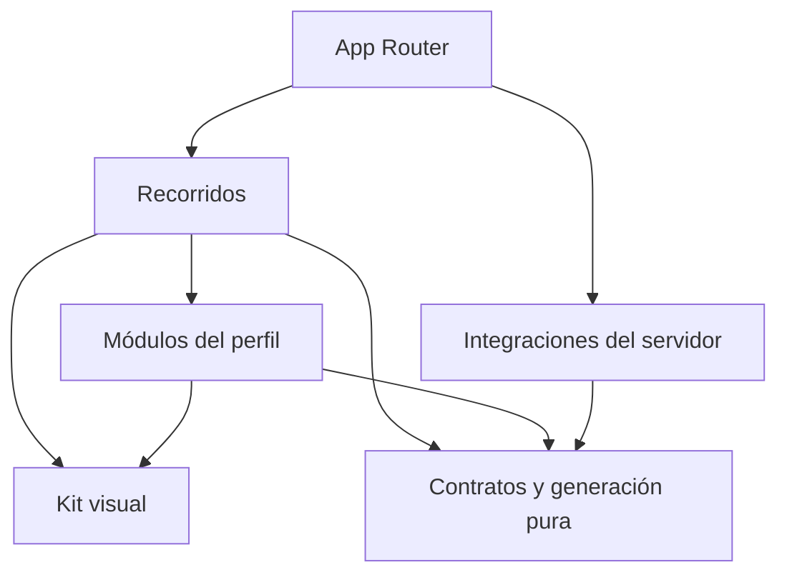

# Arquitectura

## Estado y objetivo

GitHub Profile Generator ayuda a componer un README breve mediante cinco secciones opcionales: presentación, tecnologías, proyectos, actividad y contribuciones, y contacto. Incluye Next.js App Router, TypeScript estricto, kit visual bilingüe, configuración estable, arrastre, vista previa, exportación y borrador local. Actividad integra una consulta pública configurable de GitHub y SVG propios; el recorrido manual no necesita credenciales. Conocimientos, formación y actualidad siguen retirados y sus datos v1 se conservan. No hay asistencia con IA.

`ProfileDocument` versión 1, su registro de módulos y las operaciones de creación, validación, visibilidad y orden están implementados en `src/core/`. Su API y formato se describen en [modelo del perfil](profile-model.md).

## Una aplicación, responsabilidades explícitas

El repositorio contiene una aplicación Next.js. Las carpetas delimitan responsabilidades; se crean implementaciones cuando una tarea real las necesita. No se requieren monorepo, microservicios, inyección de dependencias o capas repetidas para cada función.

| Ámbito                 | Responsabilidad                                                      | Restricciones principales                                                 |
| ---------------------- | -------------------------------------------------------------------- | ------------------------------------------------------------------------- |
| `src/app/`             | Rutas, layouts, metadatos y composición de páginas.                  | Mantener entradas pequeñas; evitar reglas del perfil dentro de las rutas. |
| `src/app/[locale]/`    | Páginas públicas y layouts localizados.                              | Validar locales soportados y emitir el `lang` correspondiente.            |
| `src/components/ui/`   | Primitivas accesibles y variantes del kit visual.                    | Sin reglas de negocio, clientes externos o estado del perfil.             |
| `src/components/`      | Composiciones visuales compartidas y proveedores necesarios.         | Extraer cuando exista reutilización o una responsabilidad clara.          |
| `src/features/`        | Editor, vista previa, exportación y persistencia local del borrador. | Coordinar módulos; no duplicar reglas de generación.                      |
| `src/modules/`         | Formularios y presentación específica de cada sección del perfil.    | No depender directamente de otros módulos.                                |
| `src/core/`            | Contrato, validación, registro, operaciones y generación del README. | TypeScript puro, sin framework, red, almacenamiento o secretos.           |
| `src/server/`          | Integraciones y operaciones que necesitan una frontera segura.       | `server-only`; sin importación desde código cliente.                      |
| `src/i18n/` y mensajes | Resolución de locale, navegación y traducciones por namespace.       | Inglés inicial, español completo y textos fuera de los componentes.       |

La ubicación exacta de archivos compartidos sigue el código existente. No mover utilidades sólo para reproducir un esquema de carpetas.

Las flechas indican dependencias permitidas, no obligatorias. `core` no depende de los demás ámbitos. El navegador sólo accede a servicios del servidor mediante una frontera explícita que valide sus entradas y controle su salida.

## Renderizado y estado

Las páginas y layouts son Server Components por defecto. Un componente se convierte en cliente cuando necesita eventos, estado o APIs del navegador. La frontera debe ser pequeña: un selector interactivo no exige que toda la página se ejecute en el cliente.

El contenido estático se renderiza primero. Las esperas independientes se aíslan con estados de carga y `Suspense` cuando se incorporen datos asíncronos. No bloquear una página entera por un módulo opcional ni duplicar solicitudes en varios componentes.

La ruta localizada del editor compone la cabecera y los mensajes en el servidor e inyecta únicamente el origen público validado de las tarjetas, sin credenciales. Usa `await connection()` para leer `APP_URL` durante cada solicitud: cambiar esa variable requiere reiniciar el servicio, sin recompilar. El editor se renderiza dinámicamente y la portada y el kit conservan su generación estática. `EditorWorkspace` posee la interacción cliente y el documento del perfil. Markdown, errores y restricciones de exportación se derivan del generador, sin otra representación del README. Los formularios viven en `src/modules/`; `EditorModules` y `ContactProviders` agrupan sus mensajes EN/ES. El registro de `core` contiene solo datos y esquemas, sin componentes ni iconos.

El editor ofrece siempre las mismas cinco secciones, sin formularios alternativos para datos retirados. El esquema y el registro conservan nueve IDs por compatibilidad interna. `knowledge`, `education` y `current` no participan en navegación ni generación aunque tengan datos o visibilidad; sus valores se conservan sin fusionarlos con presentación. Presentación prioriza nombre y texto libre; encabezado y ubicación son detalles secundarios.

La selección activa es estado efímero de UI, separado de `visibility`. Una navegación compacta presenta primero las secciones incluidas y luego las ocultas. La casilla solo cambia la inclusión, conservando su foco y los datos; el botón con el nombre selecciona el formulario y enfoca su encabezado. Para una sección oculta, la acción se identifica como agregar y editar. Un único formulario ocupa el panel de configuración junto al idioma del README; los demás formularios no están montados. Navegación, encabezado y vista previa indican qué sección se edita sin alterar el Markdown.

En pantallas amplias, la navegación, la configuración y la vista previa ocupan tres paneles. En pantallas angostas, la navegación es plegable y los botones Editar/Vista previa expresan su estado mediante `aria-pressed`. Esa selección de vista tampoco se guarda en el documento. Los controles de agregar y quitar entradas administran el foco con IDs opacos del documento y IDs DOM independientes. Los errores de salida se asocian al campo y a la sección; revisarlos selecciona el formulario, muestra la edición y enfoca el campo inválido.

`module-composition.ts` calcula las secciones activas incluidas y mueve una a un índice visible. Reconstruye `moduleOrder` colocando la secuencia visible en sus mismos espacios: los IDs ocultos, retirados y `metrics` conservan sus posiciones en el array completo de nueve elementos. La operación final pasa por `reorderModules`; ese orden determina la salida. La agrupación visual de incluidas y ocultas no introduce un segundo orden persistido.

Actividad y contribuciones pertenece al slot `contributions`. Su inclusión efectiva es `visibility.contributions || visibility.metrics`; no aparece una sexta sección. Recuperar no modifica flags. La casilla global al ocultar apaga ambos; al volver a mostrar activa contribuciones y métricas si conserva tarjetas. Los aportes manuales respetan su flag y las tarjetas el de métricas. El generador compone ambas fuentes en la posición de contribuciones y nunca renderiza métricas por separado. Su posición interna se conserva al reordenar.

El arrastre usa `@dnd-kit/react` y `@dnd-kit/dom` 0.5.1 en la frontera cliente de navegación. Solo el tirador inicia la operación, mediante sensores de puntero o teclado; escribir, marcar una casilla o seleccionar el nombre no inicia un arrastre. La restricción de gesto táctil se limita al tirador. Durante el gesto, React presenta una proyección temporal de la secuencia; se desactiva la ordenación optimista de DOM de la biblioteca para poder descartar esa proyección al cancelar o soltar fuera. Un arrastre cancelado no modifica el documento ni el orden final de la lista; un movimiento válido confirma el orden al terminar. Los botones Subir/Bajar siguen disponibles, con extremos deshabilitados y anuncios de posición. Las instrucciones y anuncios se traducen a EN/ES. La biblioteca no sustituye la revisión de foco, navegación y accesibilidad del recorrido.

`useProfileDraft` recupera el borrador después de hidratar y antes de habilitar las escrituras. El adaptador de almacenamiento valida la lectura con `parseProfileDocument`; guarda documentos válidos con una espera de 500 ms y un intento de vaciado al ocultar o abandonar la página o desmontar el editor. Un valor inválido o una lectura bloqueada impide la sustitución automática; iniciar otro borrador requiere confirmación. Si una escritura falla, se conserva el trabajo en memoria y sigue disponible la exportación válida, con un aviso persistente. No hay sincronización remota ni garantía de guardado ante un cierre abrupto.

Cuando falla el almacenamiento, un estado efímero del módulo cliente conserva el documento y su estado de recuperación entre montajes del editor, para que cambiar el idioma de interfaz no descarte lo escrito. Se consulta después de hidratar y solo se escribe desde efectos cliente; no comparte perfiles entre solicitudes del servidor. No sobrevive a una recarga completa y no habilita escrituras sobre datos inválidos.

No incorporar `useMemo`, `useCallback` o un almacén global por costumbre. Elegirlos ante una necesidad de identidad, alcance o rendimiento comprobable y mantener simple el código que no lo requiera.

## Kit visual e idiomas

La base utiliza Tailwind CSS, primitivas Radix, componentes propios con el enfoque de shadcn, variantes con CVA, iconos Lucide y temas con `next-themes`. Los colores, espaciado, tipografía, radios y estados se expresan mediante tokens compartidos. Los componentes de producto reutilizan esas decisiones en lugar de copiar estilos de una página a otra.

Las rutas son `/en`, `/es`, sus páginas `/editor` y `/design-system`; `/` redirige a `/en`. `next-intl` resuelve los mensajes por namespace. El selector conserva la página equivalente y expresa los idiomas mediante sus nombres, sin banderas. El idioma de interfaz y `contentLocale` son independientes: el selector del README cambia sus etiquetas generadas; ninguno traduce el texto escrito por la persona.

Cada interacción requiere semántica, etiqueta accesible, foco visible, uso por teclado y estados comprensibles. Respetar preferencias de movimiento y tema. Las pruebas automáticas ayudan a detectar problemas; la revisión manual comprueba foco, lectura, navegación y claridad de mensajes.

## Límites del contrato del perfil y la generación

El contrato del perfil es serializable y versionado. Separa los datos del perfil, el idioma de contenido y la composición. Conserva nueve IDs con datos y visibilidad independientes, aunque solo cinco tengan edición y salida. Sus formularios usan campos ya presentes en versión 1 y la misma clave de almacenamiento, sin migración. Los cambios de esquema necesitan una evolución explícita.

Los esquemas Zod y sus tipos inferidos pertenecen a `core`. El registro puro de los nueve módulos asocia identificador, clave de traducción, esquema y fábrica de datos vacíos; no importa componentes ni resuelve idiomas. La composición que asocie secciones con formularios pertenece a la UI. Las claves se resuelven en el namespace `Modules` de los mensajes en inglés y español.

`parseProfileDocument` recibe datos desconocidos y devuelve un resultado estructurado con datos válidos o errores de código y ruta. Rechaza propiedades desconocidas y versiones no compatibles; permite borradores incompletos. Las operaciones reciben un documento ya válido, validan sus argumentos y devuelven documentos nuevos sin mutar el original. Comparten las ramas que no cambian, por lo que el consumidor debe tratarlas como inmutables.

Ocultar una sección conserva sus datos; reordenar conserva también los IDs ocultos y retirados. La actividad pública no determina las habilidades de una persona. La validación del documento comprueba estructura e invariantes del borrador completo, sin evaluar su seguridad de salida.

`generateReadme` recibe un documento estructuralmente válido y un origen de tarjetas opcional explícito. Devuelve `ReadmeResult`: Markdown con `exportIssues` opcionales, o errores con código y ruta. Genera las cinco secciones con renderers puros en `src/core/readme/`, compone actividad en contribuciones y omite métricas como salida independiente. Omite entradas vacías y encabezados sin contenido. Permite contenido parcial sin exigir nombre, empleo o repositorio; un grupo tecnológico sin entradas exportables se omite. Traduce etiquetas según `contentLocale` y conserva los textos propios.

Los IDs retirados `knowledge`, `education` y `current` se omiten antes de revisar su contenido o enlaces, aunque su visibilidad sea verdadera. No generan `unsupported_module` ni `invalid_url`. El documento conserva sus estructuras e invariantes v1; omitir la salida no autoriza descartar esos datos al guardar o reordenar.

Un perfil sin contenido activo, un enlace no admitido en una sección activa visible o un usuario inválido para tarjetas visibles genera errores. Métricas sin tarjetas no exige usuario ni bloquea contenido manual. Las tarjetas sin origen público HTTPS generan el mismo Markdown con rutas locales y `exportIssues: activity_not_configured`: la vista previa funciona, pero copia y descarga quedan deshabilitadas. Desmarcar tarjetas permite exportar lo manual. Los datos ocultos y retirados no participan en la comprobación de salida.

Los campos son texto plano, escapado para Markdown y HTML. Los enlaces de contenido comparten una política HTTP/HTTPS absoluta sin credenciales, espacios, controles ni barras invertidas. Contacto admite además `mailto:` con un solo buzón ASCII sin parámetros; los demás módulos lo rechazan. Una URL opcional vacía es válida; una fila de enlace de contacto o proyecto con etiqueta y sin URL requiere corrección. Los errores incluyen la ruta completa, también en enlaces anidados.

Vista previa, portapapeles y descarga usan el mismo Markdown. La vista previa emplea ReactMarkdown 10.1 sin HTML libre ni plugins GFM, con elementos permitidos explícitos. El diseño del editor y su indicador de sección en edición no se exportan como CSS o contenido. Ver [editor](editor.md) y [ADR 0008](decisions/0008-focused-profile.md) para el alcance actual. Las decisiones [0004](decisions/0004-local-readme-editor.md), [0005](decisions/0005-manual-profile-composition.md), [0006](decisions/0006-editor-navigation.md) y [0007](decisions/0007-simple-profile.md) conservan el contexto histórico.

El guardado local conserva el documento completo, incluidos datos ocultos, retirados y la configuración de métricas. Tecnologías mantiene grupos e items v1. El autocompletado guarda nombre y contexto vacío en una categoría sugerida o elegida, sin exigir explicar el uso. Los detalles secundarios permiten crear, renombrar, ordenar y quitar títulos de grupos, además de mover y ordenar herramientas. Las operaciones puras reciben IDs externos y resuelven colisiones entre colecciones; la UI controla foco y anuncios. Los grupos vacíos sin nombre se ocultan sin borrarlos. Recuperar o cambiar idioma no reorganiza; la organización sugerida requiere una acción explícita. Las tecnologías de proyectos mantienen su array de strings. No existe importación o exportación de configuración mediante archivos.

## Catálogos e iconos del perfil

`src/core/technologies` contiene metadatos puros e inmutables de 358 herramientas: identificador, nombre, alias, ruta local y URL pública fijada, además de una clasificación sugerida independiente del documento. Sus nueve categorías no representan niveles ni rankings. La resolución por nombre no consulta red ni interpreta URLs escritas en el perfil. Los SVG equivalentes viven en `public/technology-icons/`. Las fuentes son Devicon, Simple Icons y Lobe Icons, fijadas a commits; las correspondencias exactas y licencias están en [recursos de terceros](../THIRD_PARTY_NOTICES.md). El README referencia esas URLs externas fijadas y depende de su disponibilidad para mostrar las imágenes en GitHub.

El renderer puro respeta grupos y orden del documento. Las tecnologías reconocidas llevan un icono decorativo de 20 × 20 junto al nombre visible escapado; las entradas sin contexto se separan con puntos medios y admiten salto de línea. Las notas se conservan en listas y los nombres propios siguen como texto escapado. La vista previa reconoce también el marcado anterior de 32 × 32; los nuevos iconos decorativos no duplican el nombre para lectores de pantalla. `wrapNamedTechnologyLabels` agrupa cada icono y nombre canónico correspondiente en un elemento inline adaptable, conservando separadores y sin modificar el Markdown. El documento no guarda URLs de iconos ni amplía el contrato v1. Ver [ADR 0012](decisions/0012-technology-categories.md).

`src/core/contact` contiene los metadatos de 13 proveedores, con dominios explícitos, ruta local y URL de icono fijada a Simple Icons. `findContactProvider` normaliza la URL con la política de contacto antes de comparar el hostname; no usa etiquetas, coincidencias parciales ni subdominios arbitrarios y no asigna marca a puertos no estándar. La selección sugerida de proveedor solo orienta el formulario y su placeholder; no se persiste. Contacto continúa guardando `links` con `id`, `label` y `url`.

El renderer de contacto agrega un icono decorativo de 20 × 20 dentro del enlace reconocido y conserva la etiqueta escapada. Si la etiqueta está vacía, usa el nombre del servicio; una URL propia o un correo sin proveedor se exporta como enlace de texto. La UI usa SVG de `public/contact-icons/` o iconos genéricos para web/correo. La marca nunca se decide por un nombre escrito por la persona.

`remarkProfileIcons` reconoce únicamente tokens que coinciden con el marcado exacto generado por los catálogos y los convierte en nodos de imagen, incluidas las imágenes decorativas dentro de enlaces de contacto. La vista previa verifica URL permitida y `alt=""` para los iconos decorativos de tecnología/contacto; para tokens tecnológicos anteriores comprueba también el nombre alternativo. Solo entonces sirve el SVG local correspondiente. Todo otro HTML sigue descartado con `skipHtml`; no se usa `rehypeRaw` ni se permite contenido HTML del usuario. Esta transformación mantiene el mismo Markdown de salida sin abrir un renderizador alternativo ni una entrada de imágenes arbitrarias.

Los iconos identifican herramientas y servicios, sin inferir habilidades ni integrar a los proveedores. Algunas entradas comparten una marca de familia, como JetBrains AI o ChatGPT/OpenAI; esas correspondencias se documentan en la atribución. Ver [ADR 0009](decisions/0009-profile-icons.md).

## Actividad pública de GitHub

`src/core/activity` define el snapshot serializable, normaliza usuarios y URLs propias y renderiza SVG pasivos y deterministas. No conoce fetch, entorno, almacenamiento ni Next.js. El documento v1 conserva únicamente usuario, tarjetas y aportes elegidos; el snapshot de calendario, recuentos, lenguajes y sugerencias es temporal.

`useGitHubActivity` consulta `/api/github/activity?username=...` por acción explícita y valida la respuesta. No consulta al escribir, abrir el bloque o recuperar el formulario. Cancela solicitudes y descarta respuestas tardías o de otro usuario; puede conservar el último resultado válido del mismo usuario ante fallos. Las tarjetas ya seleccionadas cargan su SVG al mostrarse y también pueden solicitar actividad al servidor. Cero actividad es un resultado válido, distinto de usuario inexistente, falta de configuración, cuota o indisponibilidad. Las sugerencias se guardan como aportes manuales solo al elegirlas.

Los Route Handlers de `/api/github/activity` y `/cards/github/[username]/[card]` son pequeños, validan entradas y usan `src/server/github`, marcado `server-only`. El cliente consulta un endpoint GraphQL fijo mediante POST, con `cache: no-store`, sin redirecciones, límite global de 15 s y respuesta de hasta 2 MiB. Verifica tanto errores HTTP como errores del envelope GraphQL y estructura del snapshot, sin convertir fallos en arrays o recuentos vacíos. Las rutas quedan fuera de la redirección de idioma de `proxy.ts`.

El servidor admite un PAT classic dedicado mediante `GITHUB_TOKEN`. Cada respuesta debe incluir `x-oauth-scopes` vacío o exactamente `public_repo`; cualquier scope adicional, incluidos `repo` y `read:user`, o credencial no verificable, incluidos fine-grained, falla como `not_configured`. Para GraphQL de repositorios públicos se recomienda únicamente `public_repo`, según GitHub. El cliente solo ejecuta lecturas, aunque ese scope permita otras operaciones sobre datos públicos. Es una política de esta implementación, no soporte intercambiable de todos los mecanismos de autenticación. Se rechazan perfiles privados; lenguajes solo usa repositorios públicos propios no forks y destacados excluye aportes privados/restringidos. Los recuentos privados anónimos compartidos por el perfil se explican sin exponer detalles.

La consulta recorre hasta tres páginas de 100 repositorios ordenados por actualización y hasta 20 lenguajes por repositorio; agrega hasta 100 lenguajes y señala truncamiento. Los bytes describen el código de la muestra, sin atribuir habilidades ni limitarse al período de contribuciones. Las sugerencias incluyen PR e issues públicos del período y no se agregan automáticamente.

La caché de proceso conserva hasta 512 snapshots y 512 fallos: datos frescos durante 30 minutos y último resultado válido durante hasta 24 horas ante fallos transitorios. Deduplica solicitudes del mismo usuario/día, limita a cuatro consultas distintas simultáneas y 60 por minuto, guarda fallos brevemente y respeta cooldown/Retry-After. `not_found` y `not_configured` invalidan resultados anteriores; cambiar credenciales limpia la caché correspondiente. No es una base de datos ni un límite distribuido: varias instancias necesitan protección operativa adicional.

`APP_URL` debe ser el origen HTTPS público de este despliegue, sin credenciales, puerto, ruta, query, fragmento ni host local. No se deriva del encabezado Host. Las tarjetas exportadas son URLs estables de SVG propios, sin secretos ni servicios externos de gráficos. Se vuelven a consultar según caché y dependen de la disponibilidad del despliegue. En local se revisan esas mismas imágenes con rutas relativas; el generador marca el resultado como no exportable hasta configurar origen público o desmarcar tarjetas.

Los SVG escapan XML, limitan texto, validan colores y carecen de scripts, enlaces, fuentes externas o `foreignObject`. Las respuestas incluyen CSP restrictiva y `nosniff`; usan caché pública de cinco minutos en navegador y 30 minutos compartida para datos frescos, y un minuto para stale o indisponibilidad. La tarjeta no disponible se distingue de un resultado cero. JSON devuelve estado de error y Retry-After cuando corresponde, sin tokens ni mensajes crudos. La vista previa permite solo rutas exactas propias y parámetros reconocidos, manteniendo `skipHtml`.

Los GET Route Handlers de la versión instalada de Next.js no se cachean por defecto; los datos dependientes de Request se resuelven en ejecución. La aplicación no habilita Cache Components para esta integración: usa caché explícita del servicio y encabezados de respuesta, según las guías incluidas en `node_modules/next/dist/docs/01-app/01-getting-started/15-route-handlers.md` y `08-caching.md`. Ver [ADR 0010](decisions/0010-github-activity.md).

## Asistencia con IA posterior

La asistencia con IA será una feature posterior. Propondrá cambios estructurados sobre el modelo existente, con validación y revisión del usuario antes de aplicarlos. La generación del README seguirá correspondiendo al generador puro. Se podrá aceptar o descartar una propuesta y recuperar el contenido anterior. No se inferirán capacidades a partir de actividad ni se inventará trayectoria.

Preparar esta evolución consiste en mantener separados el contrato puro, la interfaz y los servicios externos. No instalar SDKs de IA, crear endpoints públicos vacíos, incluir prompts sin consumidor ni solicitar claves hasta implementar una feature concreta. Las credenciales permanecerán en el servidor y se enviarán al proveedor únicamente los datos necesarios para la acción solicitada.

## Cambios y evidencia

Un cambio transversal requiere acordar alcance, dependencias y criterios de aceptación antes de implementarlo. La planificación se conserva en el espacio privado autorizado; la ruta local opcional `.private/planning/` queda fuera del control de versiones. La propuesta pública debe explicar su objetivo sin adjuntar ese contenido. Una decisión que cambia límites, persistencia o proveedores se registra en `docs/decisions/` con alternativas y consecuencias. Las correcciones locales no necesitan un ADR nuevo.

Las pruebas se ubican junto a la conducta que protegen o en el ámbito de integración correspondiente. Las reglas puras requieren pruebas deterministas; los componentes, interacciones significativas; las integraciones, respuestas controladas; y los recorridos completos, pruebas de navegador cuando existan. No depender de credenciales ni solicitudes facturables para la validación habitual.

La configuración y las versiones concretas viven en `package.json` y el lockfile. Este documento describe límites de responsabilidad. Consultar [trabajo con IA](ai-development.md), [contribuciones](../CONTRIBUTING.md) y la [decisión inicial](decisions/0001-architecture.md) antes de modificarlos.
