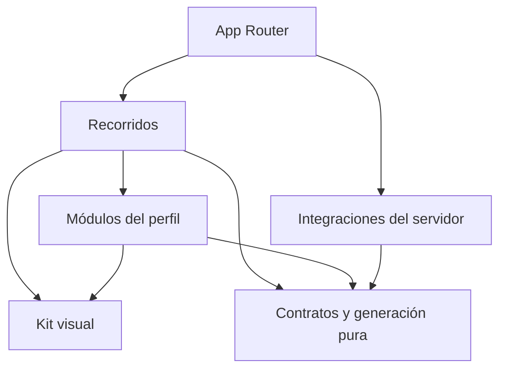

# Arquitectura

## Estado y objetivo

GitHub Profile Generator ayuda a componer un README breve mediante cinco secciones fijas opcionales y secciones personalizadas repetibles. Incluye Next.js App Router, TypeScript estricto, kit visual bilingüe, configuración estable, arrastre, vista previa, exportación y borrador local. Actividad integra una consulta pública configurable de GitHub y SVG propios; el recorrido manual no necesita credenciales. Conocimientos, formación y actualidad siguen retirados y sus estructuras heredadas se conservan. No hay asistencia con IA.

`ProfileDocument` versión 2, su orden mixto, registro de módulos, bloques personalizados y operaciones de creación, validación, visibilidad, duplicación y orden están implementados en `src/core/`. Las variantes visuales y HTML explícito amplían la composición sin cambiar la versión ni las claves de almacenamiento. Su API y compatibilidad v1 se describen en [modelo del perfil](profile-model.md).

## Una aplicación, responsabilidades explícitas

El repositorio contiene una aplicación Next.js. Las carpetas delimitan responsabilidades; se crean implementaciones cuando una tarea real las necesita. No se requieren monorepo, microservicios, inyección de dependencias o capas repetidas para cada función.

| Ámbito                 | Responsabilidad                                                      | Restricciones principales                                                 |
| ---------------------- | -------------------------------------------------------------------- | ------------------------------------------------------------------------- |
| `src/app/`             | Rutas, layouts, metadatos y composición de páginas.                  | Mantener entradas pequeñas; evitar reglas del perfil dentro de las rutas. |
| `src/app/[locale]/`    | Páginas públicas y layouts localizados.                              | Validar locales soportados y emitir el `lang` correspondiente.            |
| `src/components/ui/`   | Primitivas accesibles y variantes del kit visual.                    | Sin reglas de negocio, clientes externos o estado del perfil.             |
| `src/components/`      | Composiciones visuales compartidas y proveedores necesarios.         | Extraer cuando exista reutilización o una responsabilidad clara.          |
| `src/features/`        | Editor, vista previa, exportación y persistencia local del borrador. | Coordinar módulos; no duplicar reglas de generación.                      |
| `src/modules/`         | Formularios y presentación específica de cada sección del perfil.    | No depender directamente de otros módulos.                                |
| `src/core/`            | Contrato, validación, registro, operaciones y generación del README. | TypeScript puro, sin framework, red, almacenamiento o secretos.           |
| `src/server/`          | Integraciones y operaciones que necesitan una frontera segura.       | `server-only`; sin importación desde código cliente.                      |
| `src/i18n/` y mensajes | Resolución de locale, navegación y traducciones por namespace.       | Inglés inicial, español completo y textos fuera de los componentes.       |

La ubicación exacta de archivos compartidos sigue el código existente. No mover utilidades sólo para reproducir un esquema de carpetas.

Las flechas indican dependencias permitidas, no obligatorias. `core` no depende de los demás ámbitos. El navegador sólo accede a servicios del servidor mediante una frontera explícita que valide sus entradas y controle su salida.

## Renderizado y estado

Las páginas y layouts son Server Components por defecto. Un componente se convierte en cliente cuando necesita eventos, estado o APIs del navegador. La frontera debe ser pequeña: un selector interactivo no exige que toda la página se ejecute en el cliente.

El contenido estático se renderiza primero. Las esperas independientes se aíslan con estados de carga y `Suspense` cuando se incorporen datos asíncronos. No bloquear una página entera por un módulo opcional ni duplicar solicitudes en varios componentes.

La ruta localizada del editor compone la cabecera y los mensajes en el servidor e inyecta únicamente el origen público validado de las tarjetas, sin credenciales. Usa `await connection()` para leer `APP_URL` durante cada solicitud: cambiar esa variable requiere reiniciar el servicio, sin recompilar. El editor se renderiza dinámicamente y la portada y el kit conservan su generación estática. `EditorWorkspace` posee la interacción cliente y el documento del perfil. Markdown, errores y restricciones de exportación se derivan del generador, sin otra representación del README. Los formularios viven en `src/modules/`; `EditorModules` y `ContactProviders` agrupan sus mensajes EN/ES. El registro de `core` contiene solo datos y esquemas, sin componentes ni iconos.

El editor ofrece las mismas cinco secciones fijas, además de instancias personalizadas, sin formularios alternativos para datos retirados. El registro conserva nueve IDs fijos por compatibilidad interna. `knowledge`, `education` y `current` no participan en navegación ni generación aunque tengan datos o visibilidad; sus valores se conservan sin fusionarlos con presentación. Presentación prioriza nombre y texto libre; encabezado y ubicación son detalles secundarios. `modules/custom` edita bloques propios sin ampliar los campos de los módulos fijos. Su selector muestra nueve opciones con muestras locales decorativas y descripciones EN/ES, sin agregar contenido de ejemplo al documento. HTML tiene su propio campo de código y guía; las ayudas de listas siguen limitadas a párrafos y listas. Agregar enfoca el campo nuevo o el encabezado del separador; ordenar, quitar y duplicar conservan destinos de foco y anuncios.

La selección activa es estado efímero de UI, separado de `visibility`. Una navegación compacta presenta primero las secciones incluidas y luego las ocultas. La casilla solo cambia la inclusión, conservando su foco y los datos; el botón con el nombre selecciona el formulario y enfoca su encabezado. Para una sección oculta, la acción se identifica como agregar y editar. Un único formulario ocupa el panel de configuración junto al idioma del README; los demás formularios no están montados. Navegación, encabezado y vista previa indican qué sección se edita sin alterar el Markdown.

La navegación superior conserva la sección activa y muestra siempre una fila horizontal de secciones. Sus casillas, botones y tiradores comparten inclusión, selección y orden en la misma superficie. En pantallas amplias, configuración y vista previa ocupan dos paneles. En pantallas angostas, los botones Editar/Vista previa expresan su estado mediante `aria-pressed`; se ocultan cuando ambos paneles están visibles. Esa selección de vista tampoco se guarda en el documento. Los controles de agregar y quitar entradas administran el foco con IDs opacos del documento y IDs DOM independientes. Los errores de salida se asocian al campo y a la sección; revisarlos selecciona el formulario, muestra la edición y enfoca el campo inválido.

`module-composition.ts` calcula las referencias fijas y propias incluidas y mueve una a un índice visible. Reconstruye `sectionOrder` colocando esa secuencia en sus mismos espacios: las referencias ocultas, retiradas y de `metrics` conservan sus posiciones. Las claves de UI distinguen las instancias propias de los módulos fijos y no dependen de sus títulos. La operación final pasa por `reorderSections`; ese orden determina la salida. La agrupación visual de incluidas y ocultas no introduce un segundo orden persistido.

Actividad y contribuciones pertenece al slot `contributions`. Su inclusión efectiva es `visibility.contributions || visibility.metrics`; no aparece una sexta sección. Recuperar no modifica flags. La casilla global al ocultar apaga ambos; al volver a mostrar activa contribuciones y métricas si conserva tarjetas. Los aportes manuales respetan su flag y las tarjetas el de métricas. El generador compone ambas fuentes en la posición de contribuciones y nunca renderiza métricas por separado. Su posición interna se conserva al reordenar.

El arrastre usa `@dnd-kit/react` y `@dnd-kit/dom` 0.5.1 en la frontera cliente de navegación. Solo el tirador inicia la operación, mediante sensores de puntero o teclado; escribir, marcar una casilla o seleccionar el nombre no inicia un arrastre. La restricción de gesto táctil se limita al tirador. Durante el gesto, React presenta una proyección temporal de la secuencia; se desactiva la ordenación optimista de DOM de la biblioteca para poder descartar esa proyección al cancelar o soltar fuera. Un arrastre cancelado no modifica el documento ni el orden final de la lista; un movimiento válido confirma el orden al terminar. Los botones Subir/Bajar siguen disponibles, con extremos deshabilitados y anuncios de posición. Las instrucciones y anuncios se traducen a EN/ES. La biblioteca no sustituye la revisión de foco, navegación y accesibilidad del recorrido.

`useProfileDraft` recupera el borrador después de hidratar y antes de habilitar escrituras. El adaptador prioriza `github-profile-generator.profile.v2`; solo si falta consulta y valida el original v1 para migrarlo en memoria. Un v2 inválido o inaccesible bloquea el fallback. Recuperar o migrar no marca cambios: la primera edición guarda v2 tras 500 ms, con intento de vaciado al ocultar o abandonar la página o desmontar. La clave v1 no se sobrescribe ni elimina. Un valor inválido o una lectura bloqueada impide la sustitución automática; iniciar otro borrador requiere confirmación y escribe v2. Si una escritura falla, se conserva el trabajo en memoria y sigue disponible la exportación válida, con un aviso persistente. No hay sincronización remota ni garantía de guardado ante un cierre abrupto.

Cuando falla el almacenamiento, un estado efímero del módulo cliente conserva el documento y su estado de recuperación entre montajes del editor, para que cambiar el idioma de interfaz no descarte lo escrito. Se consulta después de hidratar y solo se escribe desde efectos cliente; no comparte perfiles entre solicitudes del servidor. No sobrevive a una recarga completa y no habilita escrituras sobre datos inválidos.

No incorporar `useMemo`, `useCallback` o un almacén global por costumbre. Elegirlos ante una necesidad de identidad, alcance o rendimiento comprobable y mantener simple el código que no lo requiera.

## Kit visual e idiomas

La base utiliza Tailwind CSS, primitivas Radix, componentes propios con el enfoque de shadcn, variantes con CVA, iconos Lucide y temas con `next-themes`. Los colores, espaciado, tipografía, radios y estados se expresan mediante tokens compartidos. Los componentes de producto reutilizan esas decisiones en lugar de copiar estilos de una página a otra.

Las rutas públicas son `/en`, `/es` y sus páginas `/editor`; `/` redirige a `/en`. La muestra `/design-system` solo está disponible en desarrollo y responde 404 en producción, sin enlaces en navegación o portada. `next-intl` resuelve los mensajes por namespace. El selector conserva la página equivalente y expresa los idiomas mediante sus nombres, sin banderas. El idioma de interfaz y `contentLocale` son independientes: el selector del README cambia sus etiquetas generadas; ninguno traduce el texto escrito por la persona.

La fila de secciones admite desplazamiento horizontal local y no salta de línea. Seleccionar conserva el foco y muestra el formulario; enfocar o reordenar revela horizontalmente el elemento sin desplazar la página en vertical. Una pareja de flechas ordena la sección activa como alternativa al arrastre. Las medidas de barra, desplazamiento y vista activa son efímeras. La barra no queda fija si ocupa más del 40% del viewport visual disponible. El selector de bloques personalizados permanece plegable. Ver [ADR 0017](decisions/0017-horizontal-section-navigation.md).

Cada interacción requiere semántica, etiqueta accesible, foco visible, uso por teclado y estados comprensibles. Respetar preferencias de movimiento y tema. Las pruebas automáticas ayudan a detectar problemas; la revisión manual comprueba foco, lectura, navegación y claridad de mensajes.

## Límites del contrato del perfil y la generación

El contrato v2 es serializable y versionado. Conserva los nueve IDs y las estructuras fijas de datos y visibilidad de v1; solo cinco tienen edición y salida. Agrega `customSections` y sustituye `moduleOrder` por `sectionOrder`, con referencias discriminadas a módulos o instancias propias. El orden contiene exactamente una referencia por cada módulo fijo y cada sección personalizada existente. Los títulos repetidos o vacíos no alteran la identidad. Los nuevos borradores usan v2 y una clave propia; el cambio está registrado en [ADR 0013](decisions/0013-custom-sections.md).

Los esquemas Zod y sus tipos inferidos pertenecen a `core`. El registro puro de los nueve módulos asocia identificador, clave de traducción, esquema y fábrica de datos vacíos; no importa componentes ni resuelve idiomas. La composición que asocie secciones con formularios pertenece a la UI. Las claves se resuelven en el namespace `Modules` de los mensajes en inglés y español.

`parseProfileDocument` recibe datos desconocidos, valida v2 o valida v1 y devuelve su migración determinista a v2. El esquema heredado permanece estricto: no acepta campos extra de la versión nueva. La migración convierte el orden fijo en referencias, agrega una colección personalizada vacía y conserva los datos sin inferencias. El parser rechaza propiedades desconocidas, referencias inválidas y versiones no compatibles; permite borradores incompletos. Las operaciones reciben un documento ya válido, validan sus argumentos y no lo mutan. Pueden compartir ramas sin cambios, por lo que el consumidor debe tratarlas como inmutables.

Las variantes `heading`, `divider`, `quote`, `image` y `html` amplían la unión discriminada de bloques dentro de v2, sin cambiar bloques anteriores, claves ni estructuras heredadas. El parser no incorpora valores por defecto a los documentos previos. Un lector antiguo estricto puede rechazar estas variantes: la recuperación debe conservar el valor incompatible, sin sobrescribirlo ni recurrir a v1. La ampliación visual y HTML se registran en [ADR 0014](decisions/0014-custom-visual-blocks.md) y [ADR 0015](decisions/0015-explicit-profile-html.md); [ADR 0013](decisions/0013-custom-sections.md) conserva el contexto del cambio inicial a v2.

Las operaciones de secciones propias agregan, actualizan, incluyen, duplican y eliminan instancias. Duplicar copia profundamente bloques e ítems, conserva textos y visibilidad y obtiene IDs nuevos mediante una función explícita. Un fallo de generación de identidades devuelve un error sin aplicar cambios parciales. Eliminar quita solo la instancia y su referencia; ocultar conserva el árbol. El formulario administra foco y anuncios; pide confirmación antes de eliminar contenido.

Ocultar una sección conserva sus datos; reordenar conserva también los IDs ocultos y retirados. La actividad pública no determina las habilidades de una persona. La validación del documento comprueba estructura e invariantes del borrador completo, sin evaluar su seguridad de salida.

`generateReadme` recibe un documento v2 válido y un origen de tarjetas opcional explícito. Devuelve `ReadmeResult`: Markdown con `exportIssues`, `customImages` y `customHtml` opcionales, o errores con código y ruta. Recorre `sectionOrder` y usa renderers puros para secciones fijas o propias visibles; compone actividad en contribuciones y omite métricas como salida independiente. Omite entradas vacías y encabezados sin cuerpo útil. Permite contenido parcial sin exigir nombre, empleo o repositorio. Traduce etiquetas generadas según `contentLocale`, conservando los textos propios.

`render-custom.ts` escapa título y texto ordinario y genera párrafos, listas ordenadas/no ordenadas, enlaces HTTP/HTTPS, subtítulos, separadores, citas, imágenes explícitas y unidades HTML filtradas. Un subtítulo usa `###` cuando hay título de sección y `##` cuando no lo hay; el separador usa `---` y la cita antepone `>` a todas sus líneas. Los ítems de listas vacíos se omiten y las continuaciones se sangran según el marcador, también con numeración de dos dígitos. Un índice local al generador alterna marcadores equivalentes entre listas emitidas para que CommonMark conserve listas separadas, incluso en secciones sin título; no hay estado global. Los errores de enlaces, imágenes y HTML señalan índices de `customSections` y `blocks`, independientes del orden visual. Una instancia oculta no participa en salida, metadatos ni validación de exportación. Las ayudas de escritura de listas pertenecen solo a párrafos y listas de `modules/custom`; el texto de los formularios fijos sigue sin interpretar Markdown.

El generador acumula `customImages` únicamente para bloques `image` válidos de secciones visibles, en el orden del Markdown y conservando repeticiones. Cada `CustomImageSource` contiene URL canónica y alternativa plana normalizada, exactamente iguales a los valores del nodo Markdown. El resultado solo incluye esa propiedad si hay imágenes y la generación tuvo éxito. Es metadato derivado para permitir imágenes Markdown en la vista previa, no una segunda representación del README ni una propiedad del borrador. Las imágenes dentro de HTML se validan como parte de sus unidades de `customHtml`.

Los IDs retirados `knowledge`, `education` y `current` se omiten antes de revisar su contenido o enlaces, aunque su visibilidad sea verdadera. No generan `unsupported_module` ni `invalid_url`. El documento conserva sus estructuras e invariantes v1; omitir la salida no autoriza descartar esos datos al guardar o reordenar.

Un perfil sin contenido activo, un enlace o imagen no admitidos en una sección visible, una imagen con URL pero sin alternativa, un bloque HTML con problemas o un usuario inválido para tarjetas visibles genera errores. Métricas sin tarjetas no exige usuario ni bloquea contenido manual. Las tarjetas sin origen público HTTPS generan el mismo Markdown con rutas locales y `exportIssues: activity_not_configured`: la vista previa funciona, pero copia y descarga quedan deshabilitadas. Desmarcar tarjetas permite exportar lo manual. Los datos ocultos y retirados no participan en la comprobación de salida.

Los campos ordinarios son texto plano, escapado para Markdown y HTML. Únicamente `html.source` admite código bajo una política explícita. Los enlaces de contenido, incluidos los de HTML, comparten una política HTTP/HTTPS absoluta sin credenciales, espacios, controles ni barras invertidas. Contacto admite además `mailto:` con un solo buzón ASCII sin parámetros; los demás módulos y HTML lo rechazan. Una URL opcional vacía es válida; una fila de enlace de contacto o proyecto con etiqueta y sin URL requiere corrección. Los errores incluyen la ruta completa, también en enlaces anidados.

Vista previa, portapapeles y descarga usan el mismo Markdown. La vista previa emplea ReactMarkdown 10.1 sin parseo global de HTML ni plugins GFM, con elementos permitidos explícitos y unidades HTML verificadas mediante metadatos derivados. El diseño del editor y su indicador de sección en edición no se exportan como CSS o contenido. Ver [editor](editor.md), [ADR 0008](decisions/0008-focused-profile.md) y [ADR 0015](decisions/0015-explicit-profile-html.md) para el alcance actual. Las decisiones [0004](decisions/0004-local-readme-editor.md), [0005](decisions/0005-manual-profile-composition.md), [0006](decisions/0006-editor-navigation.md) y [0007](decisions/0007-simple-profile.md) conservan el contexto histórico.

El guardado local conserva el documento completo, incluidos datos ocultos, retirados y la configuración de métricas. Tecnologías mantiene grupos e items v1. El autocompletado guarda nombre y contexto vacío en una categoría sugerida o elegida, sin exigir explicar el uso. Los detalles secundarios permiten crear, renombrar, ordenar y quitar títulos de grupos, además de mover y ordenar herramientas. Las operaciones puras reciben IDs externos y resuelven colisiones entre colecciones; la UI controla foco y anuncios. Los grupos vacíos sin nombre se ocultan sin borrarlos. Recuperar o cambiar idioma no reorganiza; la organización sugerida requiere una acción explícita. Las tecnologías de proyectos mantienen su array de strings. El importador conserva un último respaldo separado, con descarga de la configuración anterior y del Markdown original; no existe importación general de configuración JSON.

## Catálogos e iconos del perfil

`src/core/technologies` contiene metadatos puros e inmutables de 358 herramientas: identificador, nombre, alias, ruta local y URL pública fijada, además de una clasificación sugerida independiente del documento. Sus nueve categorías no representan niveles ni rankings. La resolución por nombre no consulta red ni interpreta URLs escritas en el perfil. Los SVG equivalentes viven en `public/technology-icons/`. Las fuentes son Devicon, Simple Icons y Lobe Icons, fijadas a commits; las correspondencias exactas y licencias están en [recursos de terceros](../THIRD_PARTY_NOTICES.md). El README referencia esas URLs externas fijadas y depende de su disponibilidad para mostrar las imágenes en GitHub.

El renderer puro respeta grupos y orden del documento. Las tecnologías reconocidas llevan un icono decorativo de 20 × 20 junto al nombre visible escapado; las entradas sin contexto se separan con puntos medios y admiten salto de línea. Las notas se conservan en listas y los nombres propios siguen como texto escapado. La vista previa reconoce también el marcado anterior de 32 × 32; los nuevos iconos decorativos no duplican el nombre para lectores de pantalla. `wrapNamedTechnologyLabels` agrupa cada icono y nombre canónico correspondiente en un elemento inline adaptable, conservando separadores y sin modificar el Markdown. El catálogo no agrega URLs de iconos ni campos a las estructuras tecnológicas heredadas. Ver [ADR 0012](decisions/0012-technology-categories.md).

`src/core/contact` contiene los metadatos de 13 proveedores, con dominios explícitos, ruta local y URL de icono fijada a Simple Icons. `findContactProvider` normaliza la URL con la política de contacto antes de comparar el hostname; no usa etiquetas, coincidencias parciales ni subdominios arbitrarios y no asigna marca a puertos no estándar. La selección sugerida de proveedor solo orienta el formulario y su placeholder; no se persiste. Contacto continúa guardando `links` con `id`, `label` y `url`.

El renderer de contacto agrega un icono decorativo de 20 × 20 dentro del enlace reconocido y conserva la etiqueta escapada. Si la etiqueta está vacía, usa el nombre del servicio; una URL propia o un correo sin proveedor se exporta como enlace de texto. La UI usa SVG de `public/contact-icons/` o iconos genéricos para web/correo. La marca nunca se decide por un nombre escrito por la persona.

`remarkProfileIcons` reconoce únicamente tokens que coinciden con el marcado exacto generado por los catálogos y los convierte en nodos de imagen, incluidas las imágenes decorativas dentro de enlaces de contacto. La vista previa verifica URL permitida y `alt=""` para los iconos decorativos de tecnología/contacto; para tokens tecnológicos anteriores comprueba también el nombre alternativo. Solo entonces sirve el SVG local correspondiente. Esta transformación no amplía la política de iconos al contenido HTML personal: los bloques `image` y las unidades de `customHtml` tienen validaciones independientes. El HTML fuera de esas unidades sigue descartado con `skipHtml`, sin `rehypeRaw`.

Los iconos identifican herramientas y servicios, sin inferir habilidades ni integrar a los proveedores. Algunas entradas comparten una marca de familia, como JetBrains AI o ChatGPT/OpenAI; esas correspondencias se documentan en la atribución. Ver [ADR 0009](decisions/0009-profile-icons.md).

## Imágenes propias de secciones personalizadas

El documento conserva `image` como `{ id, type: "image", url, alt }`. `normalizePublicImageUrl` es una función pura que admite HTTPS de dominio público sintáctico, sin IP, host local o sufijos privados conocidos, credenciales, fragmentos ni puerto no estándar. No necesita extensión de archivo y admite query. No consulta DNS, red ni disponibilidad; una URL admitida no demuestra que la respuesta sea una imagen o que vaya a permanecer publicada. La aplicación no sube archivos ni convierte rutas locales, relativas, `blob:` o `data:` en recursos públicos.

El renderer omite una imagen completamente vacía. Una descripción sin URL admitida genera `invalid_url`; una URL sin alternativa normalizada genera `missing_image_alt`. Ambos errores conservan la ruta completa hasta `url` o `alt` y bloquean toda la salida. Una imagen válida produce Markdown con alternativa escapada y URL delimitada por `<` y `>`, sin atributos HTML libres. Las secciones ocultas conservan sus imágenes sin validarlas ni incluirlas en `customImages`.

La vista previa permite una imagen propia solo si `src` y `alt` coinciden exactamente con `customImages` del mismo resultado y la URL sigue cumpliendo la política. `PublicProfileImage` usa un `img` del navegador con `loading="lazy"`, `decoding="async"` y `referrerPolicy="no-referrer"`. No pasa estos hosts por `next/image`, un proxy, un fetch de comprobación ni un optimizador del servidor. El servidor no descarga imágenes personales; el navegador sí contacta al host indicado al mostrarlas.

Un error de carga muestra descripción, aviso y enlace a la dirección, como estado efímero del componente. No cambia el documento, el Markdown ni la posibilidad de copiar o descargar una URL admitida. Esta separación distingue la política de exportación de la disponibilidad de un recurso externo. Los iconos fijos y las rutas propias de actividad conservan sus validaciones cerradas. Ver [ADR 0014](decisions/0014-custom-visual-blocks.md).

## HTML explícito de perfiles

El bloque `{ id, type: "html", source }` conserva la fuente original exacta. `analyzeProfileHtml` pertenece a `core/readme` y opera sobre AST HAST: parsea con `hast-util-from-html` 2.0.3, filtra con `hast-util-sanitize` 5.0.2 y serializa con `hast-util-to-html` 9.0.5. No depende del DOM, React o servicios remotos. El árbol y los avisos son derivados; no se guardan ni sustituyen el código personal.

La política admite HTML de perfiles: encabezados, contenedores, formato inline, listas, citas, código, enlaces, imágenes, tablas y desplegables, con alineación y dimensiones acotadas. Retira CSS, JavaScript, eventos, formularios, embeds, identificadores, clases, comentarios y atributos no admitidos. No permite `picture`, `srcset`, SVG o MathML inline. El análisis de URLs decodificadas aplica la política web para enlaces y `normalizePublicImageUrl` para imágenes; los protocolos del sanitizer no bastan porque admiten relativos. HTML exige `alt` presente y permite `alt=""` decorativo explícito. No resuelve rutas o anclas contra el editor ni interpreta Markdown dentro del código.

Antes de los recorridos se aplican 30.000 unidades UTF-16 por bloque, 1.500 nodos y profundidad 32; el generador comprueba además 150.000 unidades agregadas de HTML visible. Fuente vacía se omite. Un error de URL, alternativa, estructura, límites o fuente no vacía sin contenido útil genera `invalid_html` en `customSections/{índice}/blocks/{índice}/source` y bloquea la generación completa. Los avisos por filtrado o reparación se presentan sin borrar el original; las secciones ocultas no se analizan ni consumen presupuesto.

Cada bloque válido emite una unidad canónica cerrada dentro de un `div` en el mismo Markdown exportado. Los saltos LF/CR se codifican como `&#10;`/`&#13;` para conservar su contenido sin permitir que líneas vacías terminen la unidad HTML y reactiven Markdown. `source` mantiene el código original y el árbol, los caracteres de salto reales. `customHtml` conserva de forma derivada el HTML y su árbol HAST equivalente en estructura y contenido, identifica sus rangos `[start, end)` UTF-16 exactos en ese Markdown y su nivel base de encabezado de vista previa, `3` o `4`. `remarkCustomHtml` comprueba límites, orden y coincidencia textual antes de reemplazar únicamente esas unidades. La vista previa reutiliza el árbol permitido, sin volver a parsear la cadena serializada que puede crecer al codificar entidades; `skipHtml` conserva su efecto fuera de esas unidades.

El renderer React verifica y recorre el árbol permitido, sin `dangerouslySetInnerHTML` ni `rehypeRaw`. Adapta la jerarquía semántica de los encabezados al contexto del editor, manteniendo sus niveles h1–h6 en el HTML exportado. Las tablas admiten desplazamiento horizontal y los desplegables conservan su control nativo por teclado. Las imágenes usan carga directa del navegador con `lazy`, `async` y `no-referrer`, sin proxy del servidor; su disponibilidad es estado efímero.

El formulario personalizado muestra código, ayuda, avisos, problemas y HTML exportado inspeccionable en EN/ES. Los tres ejemplos se insertan solo por acción explícita y requieren confirmación si sustituyen código existente. La vista previa aproxima el resultado: GitHub aplica filtros y estilos propios y no se garantiza paridad. Esta excepción no añade importación de README, IA, alojamiento de imágenes o HTML en los demás campos. Ver [ADR 0015](decisions/0015-explicit-profile-html.md).

## Importación local de README

La detección de encabezados HTML usa `readme-import-html.ts`: HAST original obtiene texto y rangos; un scanner acotado conserva contexto entre nodos y confirma cierres explícitos antes de proponer un corte raíz. Los encabezados iniciales sin cuerpo permanecen juntos y no fijan la jerarquía posterior. Los segmentos conservan slices UTF-16 exactos y su etiqueta de revisión, sin añadir un título duplicado al HTML ni cambiar v2. La incertidumbre deja el contenido unido; no se clasifican módulos por etiquetas o URLs.

`src/core/import/` analiza el documento completo mediante unified, remark-parse y remark-gfm; usa mdast-util-to-hast y el analizador HTML existente para composiciones que no caben en bloques visuales. Es puro, sin React, red, DOM o almacenamiento. `analyzeReadmeImport` devuelve fuente, rangos, secciones y diagnósticos; `buildImportedProfile` valida la selección, construye v2 con secciones personalizadas y verifica el generador. Las referencias se resuelven antes de dividir; los contenedores HTML conservan su contexto. No se amplía el contrato con Markdown crudo ni se asignan módulos por heurísticas.

El panel se carga bajo demanda al abrirlo desde el editor, junto con el parser. Mantiene fuente, selección y revisión en memoria al cambiar de idioma; una confirmación nunca se reanuda automáticamente. Los originales y la salida se muestran como código React, sin montar recursos remotos. Editar fuente invalida el análisis y las respuestas tardías de lectura de archivo se descartan. La vista previa habitual se usa una vez aplicado el perfil.

`import-backup.ts` valida un registro lateral `github-profile-generator.import-backup.v1` con el perfil anterior completo y la fuente original. El hook escribe ese registro antes de reemplazar el borrador y ofrece restauración sin sobrescribirlo. La revisión síncrona del estado, `dirty` y los flags de protección impiden que un debounce, `pagehide` o desmontaje antiguos restauren el perfil anterior encima del importado. Los valores inválidos o inaccesibles no se reemplazan: continuar en memoria exige una acción explícita y no habilita autosave. La configuración JSON descargable pertenece al respaldo; no existe carga general de JSON. Ver [ADR 0018](decisions/0018-readme-import-with-backup.md).

## Actividad pública de GitHub

`src/core/activity` define el snapshot serializable, normaliza usuarios y URLs propias y renderiza SVG pasivos y deterministas. No conoce fetch, entorno, almacenamiento ni Next.js. Las estructuras fijas del documento actual conservan únicamente usuario, tarjetas y aportes elegidos; el snapshot de calendario, recuentos, lenguajes y sugerencias es temporal.

`useGitHubActivity` consulta `/api/github/activity?username=...` por acción explícita y valida la respuesta. No consulta al escribir, abrir el bloque o recuperar el formulario. Cancela solicitudes y descarta respuestas tardías o de otro usuario; puede conservar el último resultado válido del mismo usuario ante fallos. Las tarjetas ya seleccionadas cargan su SVG al mostrarse y también pueden solicitar actividad al servidor. Cero actividad es un resultado válido, distinto de usuario inexistente, falta de configuración, cuota o indisponibilidad. Las sugerencias se guardan como aportes manuales solo al elegirlas.

Los Route Handlers de `/api/github/activity` y `/cards/github/[username]/[card]` son pequeños, validan entradas y usan `src/server/github`, marcado `server-only`. El cliente consulta un endpoint GraphQL fijo mediante POST, con `cache: no-store`, sin redirecciones, límite global de 15 s y respuesta de hasta 2 MiB. Verifica tanto errores HTTP como errores del envelope GraphQL y estructura del snapshot, sin convertir fallos en arrays o recuentos vacíos. Las rutas quedan fuera de la redirección de idioma de `proxy.ts`.

El servidor admite un PAT classic dedicado mediante `GITHUB_TOKEN`. Cada respuesta debe incluir `x-oauth-scopes` vacío o exactamente `public_repo`; cualquier scope adicional, incluidos `repo` y `read:user`, o credencial no verificable, incluidos fine-grained, falla como `not_configured`. Para GraphQL de repositorios públicos se recomienda únicamente `public_repo`, según GitHub. El cliente solo ejecuta lecturas, aunque ese scope permita otras operaciones sobre datos públicos. Es una política de esta implementación, no soporte intercambiable de todos los mecanismos de autenticación. Se rechazan perfiles privados; lenguajes solo usa repositorios públicos propios no forks y destacados excluye aportes privados/restringidos. Los recuentos privados anónimos compartidos por el perfil se explican sin exponer detalles.

La consulta recorre hasta tres páginas de 100 repositorios ordenados por actualización y hasta 20 lenguajes por repositorio; agrega hasta 100 lenguajes y señala truncamiento. Los bytes describen el código de la muestra, sin atribuir habilidades ni limitarse al período de contribuciones. Las sugerencias incluyen PR e issues públicos del período y no se agregan automáticamente.

La caché de proceso conserva hasta 512 snapshots y 512 fallos: datos frescos durante 30 minutos y último resultado válido durante hasta 24 horas ante fallos transitorios. Deduplica solicitudes del mismo usuario/día, limita a cuatro consultas distintas simultáneas y 60 por minuto, guarda fallos brevemente y respeta cooldown/Retry-After. `not_found` y `not_configured` invalidan resultados anteriores; cambiar credenciales limpia la caché correspondiente. No es una base de datos ni un límite distribuido: varias instancias necesitan protección operativa adicional.

`APP_URL` debe ser el origen HTTPS público de este despliegue, sin credenciales, puerto, ruta, query, fragmento ni host local. No se deriva del encabezado Host. Las tarjetas exportadas son URLs estables de SVG propios, sin secretos ni servicios externos de gráficos. Se vuelven a consultar según caché y dependen de la disponibilidad del despliegue. En local se revisan esas mismas imágenes con rutas relativas; el generador marca el resultado como no exportable hasta configurar origen público o desmarcar tarjetas.

Los SVG escapan XML, limitan texto, validan colores y carecen de scripts, enlaces, fuentes externas o `foreignObject`. Las respuestas incluyen CSP restrictiva y `nosniff`; usan caché pública de cinco minutos en navegador y 30 minutos compartida para datos frescos, y un minuto para stale o indisponibilidad. La tarjeta no disponible se distingue de un resultado cero. JSON devuelve estado de error y Retry-After cuando corresponde, sin tokens ni mensajes crudos. La vista previa permite solo rutas exactas propias y parámetros reconocidos, manteniendo `skipHtml`.

Los GET Route Handlers de la versión instalada de Next.js no se cachean por defecto; los datos dependientes de Request se resuelven en ejecución. La aplicación no habilita Cache Components para esta integración: usa caché explícita del servicio y encabezados de respuesta, según las guías incluidas en `node_modules/next/dist/docs/01-app/01-getting-started/15-route-handlers.md` y `08-caching.md`. Ver [ADR 0010](decisions/0010-github-activity.md).

## Asistencia con IA posterior

La asistencia con IA será una feature posterior. Propondrá cambios estructurados sobre el modelo existente, con validación y revisión del usuario antes de aplicarlos. La generación del README seguirá correspondiendo al generador puro. Se podrá aceptar o descartar una propuesta y recuperar el contenido anterior. No se inferirán capacidades a partir de actividad ni se inventará trayectoria.

Preparar esta evolución consiste en mantener separados el contrato puro, la interfaz y los servicios externos. No instalar SDKs de IA, crear endpoints públicos vacíos, incluir prompts sin consumidor ni solicitar claves hasta implementar una feature concreta. Las credenciales permanecerán en el servidor y se enviarán al proveedor únicamente los datos necesarios para la acción solicitada.

## Cambios y evidencia

Un cambio transversal requiere acordar alcance, dependencias y criterios de aceptación antes de implementarlo. La planificación se conserva en el espacio privado autorizado; la ruta local opcional `.private/planning/` queda fuera del control de versiones. La propuesta pública debe explicar su objetivo sin adjuntar ese contenido. Una decisión que cambia límites, persistencia o proveedores se registra en `docs/decisions/` con alternativas y consecuencias. Las correcciones locales no necesitan un ADR nuevo.

Las pruebas se ubican junto a la conducta que protegen o en el ámbito de integración correspondiente. Las reglas puras requieren pruebas deterministas; los componentes, interacciones significativas; las integraciones, respuestas controladas; y los recorridos completos, pruebas de navegador cuando existan. No depender de credenciales ni solicitudes facturables para la validación habitual.

La configuración y las versiones concretas viven en `package.json` y el lockfile. Este documento describe límites de responsabilidad. Consultar [trabajo con IA](ai-development.md), [contribuciones](../CONTRIBUTING.md) y la [decisión inicial](decisions/0001-architecture.md) antes de modificarlos.
