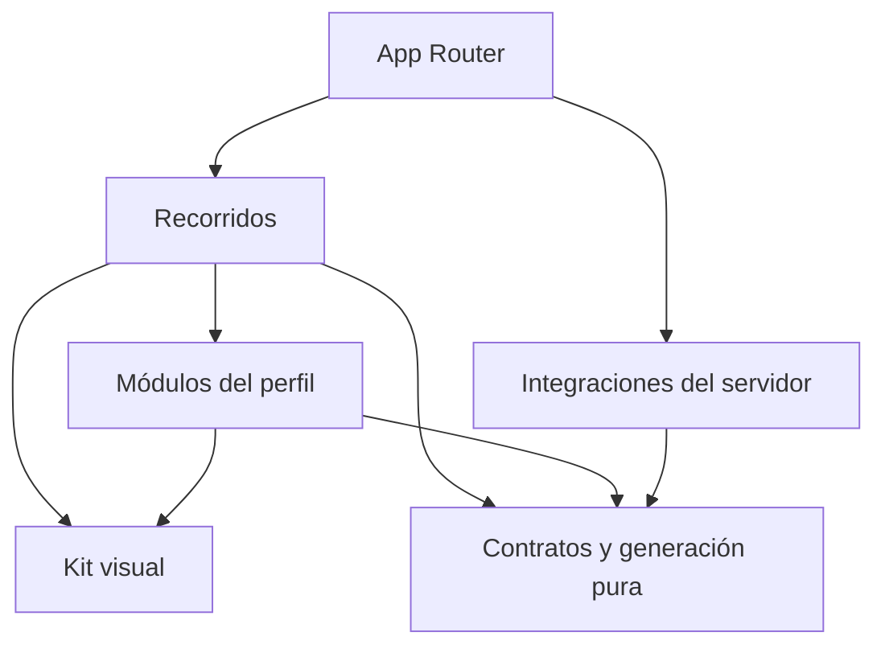

# Arquitectura

## Estado y objetivo

GitHub Profile Generator ayuda a componer un README mediante módulos opcionales. La aplicación incluye Next.js App Router, TypeScript estricto, un kit visual bilingüe y un editor funcional de presentación y contacto, con vista previa, copia, descarga y borrador local. Los demás módulos existen en el contrato; no tienen formularios ni generación de contenido. GitHub e IA no están integrados.

`ProfileDocument` versión 1, su registro de módulos y las operaciones de creación, validación, visibilidad y orden están implementados en `src/core/`. Su API y formato se describen en [modelo del perfil](profile-model.md).

## Una aplicación, responsabilidades explícitas

El repositorio contiene una aplicación Next.js. Las carpetas delimitan responsabilidades; se crean implementaciones cuando una tarea real las necesita. No se requieren monorepo, microservicios, inyección de dependencias o capas repetidas para cada función.

| Ámbito                 | Responsabilidad                                                      | Restricciones principales                                                 |
| ---------------------- | -------------------------------------------------------------------- | ------------------------------------------------------------------------- |
| `src/app/`             | Rutas, layouts, metadatos y composición de páginas.                  | Mantener entradas pequeñas; evitar reglas del perfil dentro de las rutas. |
| `src/app/[locale]/`    | Páginas públicas y layouts localizados.                              | Validar locales soportados y emitir el `lang` correspondiente.            |
| `src/components/ui/`   | Primitivas accesibles y variantes del kit visual.                    | Sin reglas de negocio, clientes externos o estado del perfil.             |
| `src/components/`      | Composiciones visuales compartidas y proveedores necesarios.         | Extraer cuando exista reutilización o una responsabilidad clara.          |
| `src/features/`        | Editor, vista previa, exportación y persistencia local del borrador. | Coordinar módulos; no duplicar reglas de generación.                      |
| `src/modules/`         | Formularios y presentación específica de cada sección del perfil.    | No depender directamente de otros módulos.                                |
| `src/core/`            | Contrato, validación, registro, operaciones y generación del README. | TypeScript puro, sin framework, red, almacenamiento o secretos.           |
| `src/server/`          | Integraciones y operaciones que necesitan una frontera segura.       | `server-only`; sin importación desde código cliente.                      |
| `src/i18n/` y mensajes | Resolución de locale, navegación y traducciones por namespace.       | Inglés inicial, español completo y textos fuera de los componentes.       |

La ubicación exacta de archivos compartidos sigue el código existente. No mover utilidades sólo para reproducir un esquema de carpetas.

Las flechas indican dependencias permitidas, no obligatorias. `core` no depende de los demás ámbitos. El navegador sólo accede a servicios del servidor mediante una frontera explícita que valide sus entradas y controle su salida.

## Renderizado y estado

Las páginas y layouts son Server Components por defecto. Un componente se convierte en cliente cuando necesita eventos, estado o APIs del navegador. La frontera debe ser pequeña: un selector interactivo no exige que toda la página se ejecute en el cliente.

El contenido estático se renderiza primero. Las esperas independientes se aíslan con estados de carga y `Suspense` cuando se incorporen datos asíncronos. No bloquear una página entera por un módulo opcional ni duplicar solicitudes en varios componentes.

La ruta localizada del editor compone la cabecera y el contexto de mensajes en el servidor. `EditorWorkspace` posee la interacción cliente y el documento del perfil. El Markdown y los errores se derivan del generador, sin mantener una segunda representación del contenido.

`useProfileDraft` recupera el borrador después de hidratar y antes de habilitar las escrituras. El adaptador de almacenamiento valida la lectura con `parseProfileDocument`; guarda documentos válidos con una espera de 500 ms y un intento de vaciado al ocultar o abandonar la página o desmontar el editor. Un valor inválido o una lectura bloqueada impide la sustitución automática; iniciar otro borrador requiere confirmación. Si una escritura falla, se conserva el trabajo en memoria y sigue disponible la exportación válida, con un aviso persistente. No hay sincronización remota ni garantía de guardado ante un cierre abrupto.

Cuando falla el almacenamiento, un estado efímero del módulo cliente conserva el documento y su estado de recuperación entre montajes del editor, para que cambiar el idioma de interfaz no descarte lo escrito. Se consulta después de hidratar y solo se escribe desde efectos cliente; no comparte perfiles entre solicitudes del servidor. No sobrevive a una recarga completa y no habilita escrituras sobre datos inválidos.

No incorporar `useMemo`, `useCallback` o un almacén global por costumbre. Elegirlos ante una necesidad de identidad, alcance o rendimiento comprobable y mantener simple el código que no lo requiera.

## Kit visual e idiomas

La base utiliza Tailwind CSS, primitivas Radix, componentes propios con el enfoque de shadcn, variantes con CVA, iconos Lucide y temas con `next-themes`. Los colores, espaciado, tipografía, radios y estados se expresan mediante tokens compartidos. Los componentes de producto reutilizan esas decisiones en lugar de copiar estilos de una página a otra.

Las rutas son `/en`, `/es`, sus páginas `/editor` y `/design-system`; `/` redirige a `/en`. `next-intl` resuelve los mensajes por namespace. El selector conserva la página equivalente y expresa los idiomas mediante sus nombres, sin banderas. El idioma de interfaz y `contentLocale` son independientes: el selector del README cambia sus etiquetas generadas; ninguno traduce el texto escrito por la persona.

Cada interacción requiere semántica, etiqueta accesible, foco visible, uso por teclado y estados comprensibles. Respetar preferencias de movimiento y tema. Las pruebas automáticas ayudan a detectar problemas; la revisión manual comprueba foco, lectura, navegación y claridad de mensajes.

## Límites del contrato del perfil y la generación

El contrato del perfil es serializable y versionado. Separa los datos del perfil, el idioma de contenido y la composición de los módulos. Todos los módulos están representados en el documento, con datos vacíos y visibilidad independiente: opcional significa que no es obligatorio mostrarlos ni completar su contenido. Los cambios de esquema necesitan una evolución explícita.

Los esquemas Zod y sus tipos inferidos pertenecen a `core`. El registro puro de los nueve módulos asocia identificador, clave de traducción, esquema y fábrica de datos vacíos; no importa componentes ni resuelve idiomas. La composición que asocie secciones con formularios pertenece a la UI. Las claves se resuelven en el namespace `Modules` de los mensajes en inglés y español.

`parseProfileDocument` recibe datos desconocidos y devuelve un resultado estructurado con datos válidos o errores de código y ruta. Rechaza propiedades desconocidas y versiones no compatibles; permite borradores incompletos. Las operaciones reciben un documento ya válido, validan sus argumentos y devuelven documentos nuevos sin mutar el original. Comparten las ramas que no cambian, por lo que el consumidor debe tratarlas como inmutables.

Ocultar un módulo conserva sus datos; reordenar conserva también los módulos ocultos. Una actividad pública baja no invalida capacidades, formación o experiencia declaradas. La validación del documento comprueba estructura e invariantes del borrador, sin evaluar su seguridad de salida.

`generateReadme` recibe un documento estructuralmente válido y devuelve `ReadmeResult`: Markdown o errores con código y ruta. Solo genera presentación y contacto visibles y con contenido. Un perfil vacío, un enlace no admitido o cualquiera de los otros siete módulos visible bloquea la exportación completa; no se descartan datos ni se produce un resultado parcial silencioso. Los datos ocultos no participan en la comprobación de salida.

Los campos son texto plano, escapado para Markdown y HTML. La política de URL admite HTTP/HTTPS absolutos sin credenciales, espacios, controles ni barras invertidas, y `mailto:` con un solo buzón ASCII sin parámetros. Vista previa, portapapeles y descarga usan el mismo Markdown. La vista previa emplea ReactMarkdown 10.1 sin HTML libre ni plugins GFM, con elementos permitidos explícitos. El diseño del editor no se exporta como CSS. Ver [editor](editor.md) y [ADR 0004](decisions/0004-local-readme-editor.md).

El guardado local conserva el documento completo, incluidos datos ocultos o módulos todavía no editables. No existe importación o exportación de configuración mediante archivos. Cualquier incorporación de esa frontera necesitará validación y una interacción que permita cancelar antes de reemplazar el trabajo existente.

## GitHub e IA: evolución prevista

Las integraciones con GitHub residirán en `server`. Antes de exponer una operación se definirán sus datos permitidos, permisos, caché, límites de uso, timeout y tratamiento de errores. Un fallo externo dejará disponible la edición manual. Las métricas exportadas como captura y las tarjetas que continúan actualizándose tendrán comportamientos explícitos y diferentes requisitos de alojamiento.

La asistencia con IA será una feature posterior. Propondrá cambios estructurados sobre el modelo existente, con validación y revisión del usuario antes de aplicarlos. La generación del README seguirá correspondiendo al generador puro. Se podrá aceptar o descartar una propuesta y recuperar el contenido anterior. No se inferirán capacidades a partir de actividad ni se inventará trayectoria.

Preparar esta evolución consiste en mantener separados el contrato puro, la interfaz y los servicios externos. No instalar SDKs de IA, crear endpoints públicos vacíos, incluir prompts sin consumidor ni solicitar claves hasta implementar una feature concreta. Las credenciales permanecerán en el servidor y se enviarán al proveedor únicamente los datos necesarios para la acción solicitada.

## Cambios y evidencia

Un cambio transversal requiere acordar alcance, dependencias y criterios de aceptación antes de implementarlo. La planificación se conserva en el espacio privado autorizado; la ruta local opcional `.private/planning/` queda fuera del control de versiones. La propuesta pública debe explicar su objetivo sin adjuntar ese contenido. Una decisión que cambia límites, persistencia o proveedores se registra en `docs/decisions/` con alternativas y consecuencias. Las correcciones locales no necesitan un ADR nuevo.

Las pruebas se ubican junto a la conducta que protegen o en el ámbito de integración correspondiente. Las reglas puras requieren pruebas deterministas; los componentes, interacciones significativas; las integraciones, respuestas controladas; y los recorridos completos, pruebas de navegador cuando existan. No depender de credenciales ni solicitudes facturables para la validación habitual.

La configuración y las versiones concretas viven en `package.json` y el lockfile. Este documento describe límites de responsabilidad. Consultar [trabajo con IA](ai-development.md), [contribuciones](../CONTRIBUTING.md) y la [decisión inicial](decisions/0001-architecture.md) antes de modificarlos.
